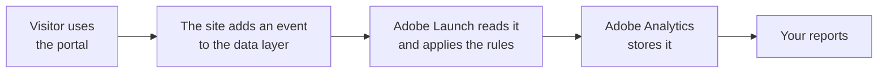

# GMAD Portal: Data Layer Specification

**New York Life Group Membership (GMAD) · Version 1.0 · Draft for review on 2026-10-13**

This specification describes what the new GMAD association portal records about visits and
applications, so that the analytics reports keep working when the portal moves to the new design.
It is written for two readers:

- **Business owners and leadership**, who approve what is measured and why. Start with this page,
  then [How it works](how-it-works.md), [Privacy](privacy.md) and the
  [decisions we need from you](open-questions.md).
- **Developers**, who build it. Read [How it works](how-it-works.md), then the
  [seven event pages](#the-seven-events) and the [reference pages](#reference).

## In one minute

- **The new portal has no analytics yet.** It is one design, reskinned for each association.
- **The site will describe what happens in a small set of messages, called events.** For example:
  "a page was viewed", "a quote returned two products", "the application was submitted". The
  messages go into a shared list on the page called the **data layer** (`window.appEventData`).
- **Adobe Launch, the tag manager, reads those events** and sends them to Adobe Analytics. The site
  never talks to Adobe directly, so the tracking setup can change without changing the site.
- **Seven events cover the whole portal.** Each has its own page with examples.
- **Nothing a person types is ever recorded**: no names, dates of birth, ZIP codes, health answers
  or payment details. Only the names of fields that were completed, never what was entered. See
  [Privacy](privacy.md).

## What it covers

The scope is the data behind **two Adobe Analytics reports**: the **MOAA Monthly Workspace** and the
**Portal Analytics Executive Report | 2026**. Those two reports use **41 distinct components**
(metrics, dimensions and segments). [Reports](reference/reports.md) lists each one and what feeds it.

Two kinds of items appear in the pages that follow:
- **Needed for your reports**: an item that feeds one of the 41 components.
- **Recommended**: an item beyond the two reports that we suggest for a fuller picture. Each is
  labelled, and you decide whether it is built.

This scope covers the two reports, not every question the business may want to ask later.

## How it works, in one picture

Every page view, including each step of the single-page application, follows the same sequence.
[How it works](how-it-works.md) shows it, along with which event fires where.

## The seven events

| Event | What it records | Page |
|---|---|---|
| **Page Load Started** | A page view begins: which page, which association, which campaign | [events/page-load-started.md](events/page-load-started.md) |
| **User Detected** | Whether the visitor is a consumer or an advisor, and whether their identity was checked | [events/user-detected.md](events/user-detected.md) |
| **Page Load Completed** | The page view is complete and can be sent | [events/page-load-completed.md](events/page-load-completed.md) |
| **Interaction** | A click on a tracked link or button: contact, download, print, a window opening or closing, and the element clicked | [events/interaction.md](events/interaction.md) |
| **Form Activity** | How a form is used: shown, steps, fields completed, errors | [events/form-activity.md](events/form-activity.md) |
| **Login Activity** | An identity check: the advisor login and the consumer's resume code. Started, succeeded, failed, logged out | [events/login-activity.md](events/login-activity.md) |
| **Application Activity** | Progress through the quote and the application, from the first quote to the receipt | [events/application-activity.md](events/application-activity.md) |

## Reference

| Page | What it holds |
|---|---|
| [How it works](how-it-works.md) | The data layer in plain words, the page view sequence, which event fires where |
| [The application journey](application-journey.md) | Every step of the application, and the knockout, resume and advisor paths |
| [Products](reference/products.md) | How the products a visitor sees and chooses are described |
| [Form fields](reference/form-fields.md) | The only field names a form may report |
| [Reports](reference/reports.md) | The 41 report components and what feeds each one |
| [Privacy](privacy.md) | What is never recorded, and how the design keeps it that way |
| [Checking a build](checking-a-build.md) | How to test the build before it goes live |
| [Decisions we need](open-questions.md) | Questions only New York Life can answer, with owners |

## Status and next steps

| Date | What |
|---|---|
| 2026-10-09 | Knowledge transfer session: the data layer and the tag manager |
| 2026-10-13 | First specification review |
| 2026-10-15 and 2026-10-23 | Developer office hours |
| October to December 2026 | Portal build |

**Nothing is built yet.** Items marked **Proposed** are our recommendation and need your approval.
Items that wait on an answer from New York Life link to [Decisions we need](open-questions.md).
They are written into the specification as proposed, so the build is not held up while you decide.

## How changes are made

- **Version 1.x** adds optional details and never breaks what is already built.
- **Version 2.0** would rename or remove an event or a property the reports depend on.
- Every change is dated in the [change log](#change-log) and reviewed before it ships.

## Change log

| Version | Date | Change |
|---|---|---|
| 1.0 | 2026-10-13 | First version, for review |
