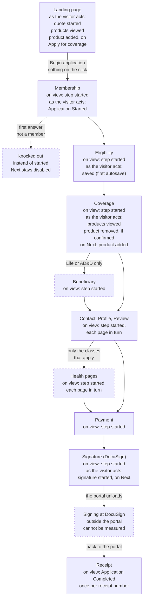
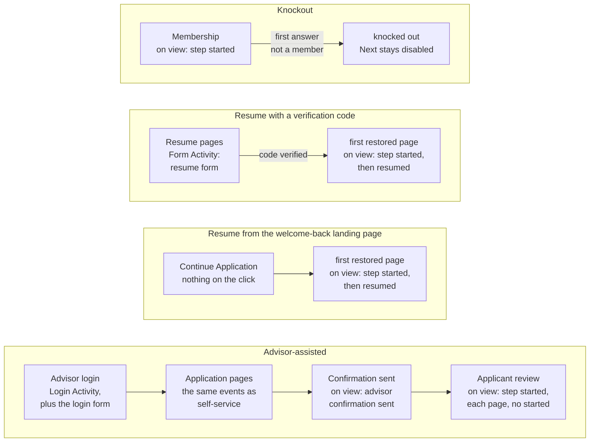

# The application journey

[Back to the overview](README.md)

This page follows one self-service application from the first quote to the receipt, then the
other ways in: knockout, resume and advisor-assisted. All of these are
[Application Activity](events/application-activity.md) unless marked otherwise; the first
Membership input is [Application Started](events/application-started.md), and the receipt is
[Application Completed](events/application-completed.md).

## Self-service, quote to receipt

Each box is one page view. **On view** actions travel with the page view. **As the visitor acts**
actions are separate hits. Dashed boxes appear only when they apply.

- **Each validated Next**, from Membership to Payment, also adds "step completed" to the data layer
  just before the page changes. It is not sent to Adobe yet ([decision 9](open-questions.md)).
- **Signing happens outside the portal**, so it cannot be measured. A return to the receipt page is
  the only sign that it was completed ([decision 18](open-questions.md)).
- **Revisits count.** Back, Edit and a reload record the step again, marked as a repeat, so the
  reports count step views.

## Knockout, resume and advisor-assisted

- **Application Started and saved never fire on a resumed application:** it was already started and saved.
- **Advisor-assisted applications** carry `application.channel: "advisor-assisted"`. Who owns this
  flow, and three details of it, are [decision 7](open-questions.md).

## One application, at a glance

What a typical application sends to Adobe, in order. PLS, UD and PLC are Page Load Started, User
Detected and Page Load Completed.

| Step | Events, in order | Sent to Adobe as |
|---|---|---|
| Landing page | PLS, UD, PLC | a page view |
| Quote drawer | quote started, products viewed, product added (on Apply for coverage) | 3 separate hits |
| Begin application | nothing | none |
| Membership | PLS, UD, step started (1), PLC; then Application Started, and an error if Next fails | a page view; then separate hits |
| Eligibility | PLS, UD, step started (2), PLC; then saved | a page view; a hit |
| Coverage | PLS, UD, step started (3), PLC; then products viewed; product added on Next | a page view; 2 hits |
| Beneficiary | PLS, UD, step started (4), PLC; Add Beneficiary opens a window | a page view; a hit |
| Contact, Profile, Review | PLS, UD, step started, PLC each; Print on Review | a page view each; a hit |
| Health pages that apply | PLS, UD, step started, PLC each | a page view each |
| Payment | PLS, UD, step started, PLC | a page view |
| Signature | PLS, UD, step started, PLC; then signature started | a page view; a hit |
| DocuSign | nothing: outside the portal | none |
| Receipt | PLS, UD, Application Completed, PLC; Application PDF if clicked | a page view; a hit |
