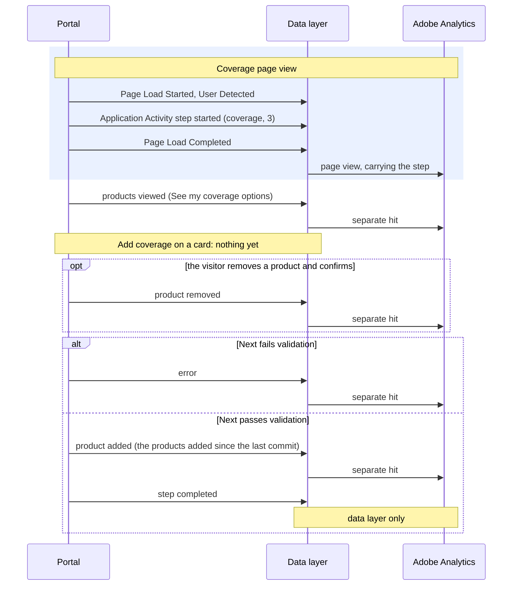

# Application Activity

**Event name:** `Application Activity` · Needed for your reports

[Back to the overview](../README.md)

## What it answers

- How many visitors start a quote, see products and add them to the cart.
- How many reach each application step, and where they drop off.
- Which products are viewed, added and removed.
- How many are stopped at Membership, how many save, how many resume, how many leave to sign.
- Where the application and the instant quote panel block a visitor: on which page, and why
  (a missing or badly formatted answer), never which field or what was typed.
- One application followed across visits, through its masked application id.
- How many advisor-prepared applications are sent.

The whole journey, page by page, is on [The application journey](../application-journey.md).

## When to fire it

- **Fire this event when the visitor makes progress in the quote or the application** (the
  [actions below](#actions)), when the result happens, not on the click: products viewed when the
  results arrive.
- **Fire it on every experience the same way**, with or without the instant quote panel
  ([the rule](../how-it-works.md#which-event-fires-where-the-two-landing-experiences)).
- **Fire the page-view actions** (`step-started`, `resumed`, `advisor-confirmation-sent`) between
  User Detected and Page Load Completed, so they travel with the page view. Fire the others when
  they happen, each as its own hit.
- **Products are recorded when the visitor commits, not on every selection.** Add, Add coverage,
  a card selection or an amount change records nothing. `product-added` fires once per commit (a
  Next on Coverage that passes validation, or "Apply for coverage" in the quote drawer) and holds
  every product added since the last commit. `product-removed` fires when a removal is confirmed.
- **No field-level tracking** (agreed at the 2026-10-23 office hours): nothing says which field
  was completed or which field was in error. A Next or "Get an instant quote" that is blocked
  records one `error`, with its type and code only, never message text. So does each portal
  message listed under [Error codes](#error-codes) (a link that fails or has expired, a completed
  application, an advisor request that is no longer valid, an expired session).
- **Never repeat a once-only action on a reload:** remember `saved` for the application.
- **Do not fire it for:** the Begin application click, messages the system shows by itself other
  than those under [Error codes](#error-codes), a
  screen refreshing, answers on the profile, health, payment or beneficiary pages, the resume and
  advisor login forms ([Login Activity](login-activity.md)), or the clicks listed under
  [Click Interaction](click-interaction.md).
- **Never send PII or an applicant's answers**: no names, contact details, SSNs, dates of birth,
  health responses, or personal financial figures. Product catalog details (id, name, category,
  underwriting class) are product information and are sent. A product's price and the selected
  benefit amount come from the applicant's own answers, so they are treated as PII and never sent
  (agreed on 2026-10-27). See [Privacy](../privacy.md).

## Actions

`application.action` says what happened. These are all the actions expected, with the exact
moment each one fires:

| `application.action` | Fire it when (the exact moment) | Where | How often | Products it holds | With the page view or its own hit | Use |
|---|---|---|---|---|---|---|
| `quote-started` | The first input in the quote. Not when the drawer or panel opens | quote drawer; instant quote panel | once per quote | none | its own hit | Recommended |
| `products-viewed` | "See my quote", "Get an instant quote" or "See my coverage options" returns results, when they arrive | quote drawer; instant quote panel; Coverage | once per search with results | every product returned | its own hit | Your reports: Product |
| `product-added` | The visitor commits the cart: a Next on Coverage that passes validation, or "Apply for coverage" in the quote drawer. Not on Add, a selection or an amount change | Coverage; quote drawer | once per commit that adds products | the products added since the last commit | its own hit | Your reports: Product |
| `product-removed` | The visitor confirms a removal in the coverage cart | coverage cart | once per confirmed removal | the removed product | its own hit | Recommended |
| `step-started` | An application page is on screen, Membership to Signature, revisits included (marked as a repeat) | application pages | every view | the cart at that moment, or none | with the page view | Your reports: Eligibility, Coverage, Preview, and Contact and Signature on those pages ([decision 4](../open-questions.md), answered). Proposed: every view counts |
| `error` | A Next or "Get an instant quote" is blocked by validation or rejected by the server, one per attempt, not per field; or a message under [Error codes](#error-codes) shows | application pages; instant quote panel; the page that shows the message | once per blocked attempt or message shown | none | its own hit | Recommended |
| `step-completed` | Next passes validation, Membership to Payment, just before the page changes | application pages | once per validated Next | none | data layer only, not sent yet ([decision 9](../open-questions.md)) | Recommended, Proposed |
| `saved` | The first successful autosave, after Membership | application pages | once per application | none | its own hit | Recommended |
| `knocked-out` | The applicant is stopped: the first Membership answer is "not a member", or another Membership question or the Eligibility page (age, state, or questions set per association) stops them. The message shows and Next stays disabled ([decision 17](../open-questions.md), answered). Not every site asks the membership question, and on a few a "no" does not stop the applicant: then nothing fires here. The answer itself is a [Click Interaction](click-interaction.md#tracked-controls) | Membership; Eligibility | each time it is shown | none | its own hit | Recommended |
| `resumed` | The first application page after a resume (code accepted, or Continue Application on the welcome-back page) | the first restored page | once per resume | the cart at that moment | with the page view | Recommended |
| `esign-started` | Next on the Signature page, as the visitor leaves for DocuSign | Signature | once per Next | none | its own hit | Recommended (Signature counts the page, not leaving it) |
| `advisor-confirmation-sent` | The advisor's "Application sent successfully" page shows | advisor portal | every view | none | with the page view | Your reports: Advisor Confirmation |

## Error codes

`application.error.code` comes from this fixed list, never from the message text. The portal
messages come from your developers' list (decision 19, 2026-10-30); each scenario sends one code,
whatever its title, message and hint say. Your developers map each message to its code.

| Scenario | Your message keys | `error.type` | `error.code` |
|---|---|---|---|
| Sending the application link fails | `linkErrorConfirmTitle`, `linkErrorConfirmHeaderMessage`, `linkErrorConfirmHeaderHint` | `system` | `link-send-failed` |
| The emailed link has expired | `linkInvalidConfirmTitle`, `linkInvalidConfirmHeaderMessage` | `system` | `link-expired` |
| The emailed link cannot be validated | `linkValidationErrorConfirmTitle`, `linkValidationErrorConfirmHeaderMessage` | `system` | `link-validation-failed` |
| The application was already submitted | `appCompletedConfirmTitle`, `appCompletedConfirmHeaderMessage` | `system` | `application-completed` |
| Advisor flow: the request is no longer valid | mapped by your developers ([decision 19](../open-questions.md)) | `system` | `advisor-request-invalid` |
| Advisor flow: the signature request is no longer valid | mapped by your developers | `system` | `signature-request-invalid` |
| Advisor flow: the session is no longer valid | mapped by your developers | `system` | `session-invalid` |
| Advisor flow: the advisor is editing the application | mapped by your developers | `system` | `application-being-edited` |
| The session timed out (45 minutes) and an action is refused | mapped by your developers | `system` | `session-expired` |
| Next or "Get an instant quote" blocked by validation | none (no field is named) | `validation` | `required-missing`, `invalid-format` |
| The server rejects a Next or a quote | mapped by your developers | `submission` | `service-unavailable` |

A refresh after a timeout returns the visitor to the landing page (decision 28, 2026-10-30): that
is a new landing page view, not a resume, and records no `error`.

The application's start and its submit are their own events:
[Application Started](application-started.md) and [Application Completed](application-completed.md).

## Example

One application page, Coverage:



The step travels with the page view. The cart is recorded when the visitor commits it with Next;
each product action is its own hit. The completed step stays in the data layer for now.

## Javascript code

```js
window.appEventData = window.appEventData || [];
window.appEventData.push({
  "event": "Application Activity",
  "application": {
    "action": "<action>",
    "channel": "<channel>",
    "applicationId": "<applicationId>",
    "step": {
      "name": "<stepName>",
      "group": "<stepGroup>",
      "number": "<stepNumber>",
      "repeat": "<stepRepeat>"
    },
    "knockoutReason": "<knockoutReason>",
    "error": {
      "type": "<errorType>",
      "code": "<errorCode>"
    },
    "product": [
      {
        "productInfo": {
          "productID": "<productID>",
          "name": "<productName>",
          "category": "<productCategory>",
          "underwritingClass": "<underwritingClass>"
        },
        "quantity": "<quantity>",
        "quickDecisionEligible": "<quickDecisionEligible>"
      }
    ]
  }
});
```

## Populated example

The coverage page, a search that returns two products:

```js
window.appEventData = window.appEventData || [];
window.appEventData.push({
  "event": "Application Activity",
  "application": {
    "action": "products-viewed",
    "channel": "self-service",
    "applicationId": null,
    "step": {
      "name": null,
      "group": null,
      "number": null,
      "repeat": null
    },
    "knockoutReason": null,
    "error": {
      "type": null,
      "code": null
    },
    "product": [
      {
        "productInfo": {
          "productID": "G-4120-1",
          "name": "Group Term Life",
          "category": "term-life",
          "underwritingClass": "si"
        },
        "quantity": 1,
        "quickDecisionEligible": true
      },
      {
        "productInfo": {
          "productID": "G-5210-1",
          "name": "Group Disability Income",
          "category": "disability",
          "underwritingClass": "di"
        },
        "quantity": 1,
        "quickDecisionEligible": false
      }
    ]
  }
});
```

Membership, Next pressed with the email left empty:

```js
window.appEventData = window.appEventData || [];
window.appEventData.push({
  "event": "Application Activity",
  "application": {
    "action": "error",
    "channel": "self-service",
    "applicationId": "4f9c2a7e1b83",
    "step": {
      "name": "membership",
      "group": "getting-started",
      "number": 1,
      "repeat": false
    },
    "knockoutReason": null,
    "error": {
      "type": "validation",
      "code": "required-missing"
    },
    "product": []
  }
});
```

## Variable definitions

All details are sent every time; a detail that does not apply is `null`, and `product` is `[]`
when no product is involved.

| Path | Type | Description | Example |
|---|---|---|---|
| `application.action` | string | Required. For your reports. What happened ([Actions](#actions)) | `products-viewed`, `product-added`, `step-started` |
| `application.channel` | string | Required. Recommended. Who is completing the application | `self-service`, `advisor-assisted` |
| `application.applicationId` | string or null | Required. Recommended. A masked id for this application, the same from the moment it is created through saves and resumes to the receipt, so one application can be followed across visits (agreed on 2026-10-23). The front end provides the masked value, never the database id, never anything typed (2026-10-27). Empty before the application exists, and `null` until the masked id is built (your developers target the end of 2026; [decision 27](../open-questions.md)) | `4f9c2a7e1b83` |
| `application.step.name` | string or null | Required on step actions. For your reports. The application page | `membership`, `eligibility`, `coverage`, `review`, `payment`, `docusign` |
| `application.step.group` | string or null | Required with a step. Recommended. The progress stage | `getting-started`, `coverage-options`, `profile`, `application-review`, `esign-submit` |
| `application.step.number` | integer or null | Required with a step. Recommended. The step's position in this application's flow | `1`, `2`, `3` |
| `application.step.repeat` | boolean or null | Required with a step. Recommended. `true` when this step was already viewed for this application in this visit | `true`, `false` |
| `application.knockoutReason` | string or null | Required on `knocked-out`. Recommended. Why the applicant was stopped: `not-member` for the membership answer, `eligibility-not-met` for any other rule. The portal shows one general message, so there is no finer reason | `not-member`, `eligibility-not-met` |
| `application.error.type` | string or null | Required on `error`. Recommended. What kind of error. Empty on the health pages, where it could reveal an answer | `validation`, `submission`, `system` |
| `application.error.code` | string or null | Required on `error`. Recommended. The reason, from a fixed list, never the message text ([decision 19](../open-questions.md)). Empty on the health pages | `required-missing`, `invalid-format`, `service-unavailable` |
| `application.product` | array | Required. For your reports. The products this event is about: the results, the products committed or removed, or the cart on a step. See [Products](../reference/products.md) | a list, or `[]` |
| `application.product[n].productInfo.productID` | string | Required. For your reports. A stable product id: the G-number ([decision 14](../open-questions.md), answered) | `G-4120-1` |
| `application.product[n].productInfo.name` | string | Required. Recommended. The product name as configured | `Group Term Life` |
| `application.product[n].productInfo.category` | string | Required. Recommended. The product category | `term-life`, `disability` |
| `application.product[n].productInfo.underwritingClass` | string or null | Required. Recommended. The product's underwriting class | `si`, `gi` |
| `application.product[n].quantity` | integer | Required. Recommended. Always `1`: it never counts people | `1` |
| `application.product[n].quickDecisionEligible` | boolean | Required. Recommended. Whether the product offers a quick decision | `true`, `false` |

## How to check it

1. Walk one application with test details. Each step shows a step started between Page Load Started
   and Page Load Completed.
2. Reload the Eligibility page: step started again with `repeat: true`.
3. Run a coverage search: a products viewed hit fires on its own, holding every product returned.
   Add one: nothing fires. Press Next: one product added hit fires, holding the products added.
4. Press Next with a required field empty: one error hit, with `required-missing` and no field
   name. No form event fires anywhere in the application.
5. After the first Membership input, every application push carries the same `application.applicationId`;
   resume the application later: the same id.
6. Each push has `event` and `application` only, and `application.product` is always a list.
