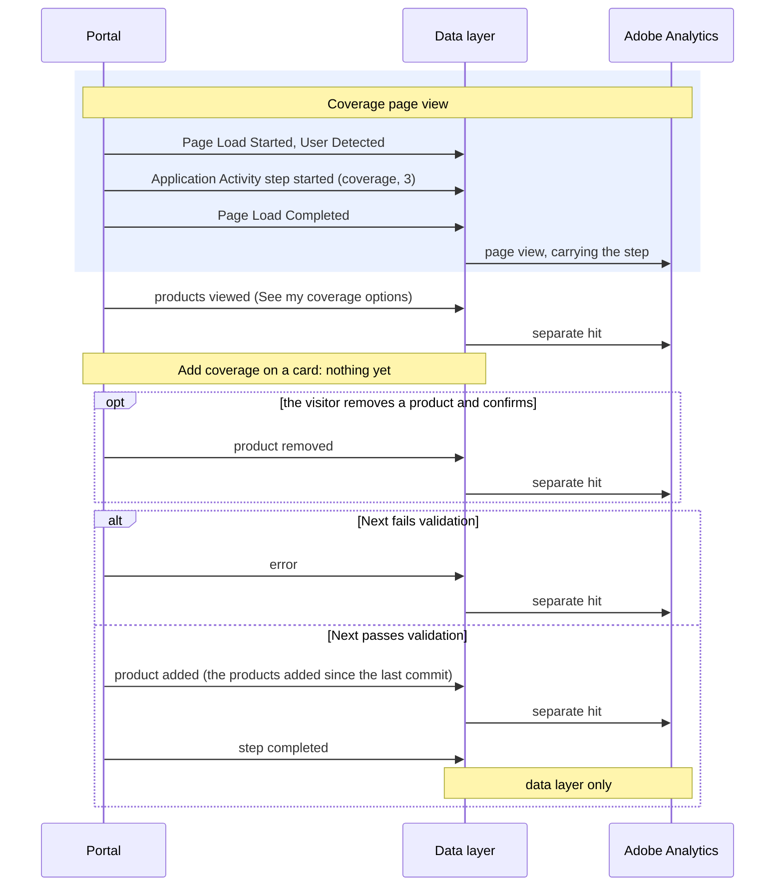

# Application Activity

**Event name:** `Application Activity` · Needed for your reports

[Back to the overview](../README.md)

## What it answers

- How many visitors start a quote, see products and add them to the cart.
- How many reach each application step, and where they drop off.
- Which products are viewed, added and removed.
- How many are stopped at Membership, how many save, how many resume, how many leave to sign.
- Where the application and the instant quote panel fail: which field causes errors, and why,
  never what was typed.
- How many advisor-prepared applications are sent.

The whole journey, page by page, is on [The application journey](../application-journey.md).

## When to fire it

- **Fire this event when the visitor makes progress in the quote or the application** (the
  [actions below](#actions)), when the result happens, not on the click: products viewed when the
  results arrive.
- **Fire it on every experience the same way**, with or without the instant quote panel
  ([the rule](../how-it-works.md#which-event-fires-where-the-two-landing-experiences)).
- **Fire the page-view actions** (`step-started`, `resumed`, `advisor-confirmation-sent`) between
  User Detected and Page Load Completed, so they travel with the page view. Fire the others when
  they happen, each as its own hit.
- **Products are recorded when the visitor commits, not on every selection.** Add, Add coverage,
  a card selection or an amount change records nothing. `product-added` fires once per commit (a
  Next on Coverage that passes validation, or "Apply for coverage" in the quote drawer) and holds
  every product added since the last commit. `product-removed` fires when a removal is confirmed.
- **Form use inside the application and the quote is recorded here**, not in
  [Form Activity](form-activity.md): a listed field completed (`field-completed`) and a Next or
  "Get an instant quote" that is blocked (`error`). Field names only, from the
  [form fields list](../reference/form-fields.md); never what was typed, and never error message
  text.
- **Never repeat a once-only action on a reload:** remember `saved` for the application.
- **Do not fire it for:** the Begin application click, messages the system shows by itself, a
  screen refreshing, answers on the profile, health, payment or beneficiary pages, the resume and
  advisor login forms ([Form Activity](form-activity.md)), or the clicks listed under
  [Click Interaction](click-interaction.md).
- **Never send PII or an applicant's answers**: no names, contact details, SSNs, dates of birth,
  health responses, or personal financial figures. Product-level values (a product's price and the
  selected coverage amount) are product information, not PII, and are sent. See [Privacy](../privacy.md).

## Actions

`application.action` says what happened. These are all the actions expected, with the exact
moment each one fires:

| `application.action` | Fire it when (the exact moment) | Where | How often | Products it holds | With the page view or its own hit | Use |
|---|---|---|---|---|---|---|
| `quote-started` | The first input in the quote. Not when the drawer or panel opens | quote drawer; instant quote panel | once per quote | none | its own hit | Recommended |
| `products-viewed` | "See my quote", "Get an instant quote" or "See my coverage options" returns results, when they arrive | quote drawer; instant quote panel; Coverage | once per search with results | every product returned | its own hit | Your reports: Product |
| `product-added` | The visitor commits the cart: a Next on Coverage that passes validation, or "Apply for coverage" in the quote drawer. Not on Add, a selection or an amount change | Coverage; quote drawer | once per commit that adds products | the products added since the last commit | its own hit | Your reports: Product |
| `product-removed` | The visitor confirms a removal in the coverage cart | coverage cart | once per confirmed removal | the removed product | its own hit | Recommended |
| `step-started` | An application page is on screen, Membership to Signature, revisits included (marked as a repeat) | application pages | every view | the cart at that moment, or none | with the page view | Your reports: Eligibility, Coverage, Preview (Proposed: every view counts) |
| `field-completed` | A listed field is completed: its first change, then the visitor moves on | application pages; instant quote panel | once per field per page view | none | data layer only, not sent yet ([decision 9](../open-questions.md)) | Recommended |
| `error` | A Next or "Get an instant quote" is blocked by validation or rejected by the server. One per attempt, not per field | application pages; instant quote panel | once per blocked attempt | none | its own hit | Recommended |
| `step-completed` | Next passes validation, Membership to Payment, just before the page changes | application pages | once per validated Next | none | data layer only, not sent yet ([decision 9](../open-questions.md)) | Recommended, Proposed |
| `saved` | The first successful autosave, after Membership | application pages | once per application | none | its own hit | Recommended |
| `knocked-out` | The first Membership answer is "not a member": the message shows and Next stays disabled. An eligibility rule is a Proposed second reason ([decision 17](../open-questions.md)) | Membership; Eligibility | each time it is shown | none | its own hit | Recommended |
| `resumed` | The first application page after a resume (code accepted, or Continue Application on the welcome-back page) | the first restored page | once per resume | the cart at that moment | with the page view | Recommended |
| `esign-started` | Next on the Signature page, as the visitor leaves for DocuSign | Signature | once per Next | none | its own hit | Your reports: Signature, possibly ([decision 4](../open-questions.md)) |
| `advisor-confirmation-sent` | The advisor's "Application sent successfully" page shows | advisor portal | every view | none | with the page view | Your reports: Advisor Confirmation |

The application's start and its submit are their own events:
[Application Started](application-started.md) and [Application Completed](application-completed.md).

## Example

One application page, Coverage:



The step travels with the page view. The cart is recorded when the visitor commits it with Next;
each product action is its own hit. The completed step stays in the data layer for now.

## Javascript code

```js
window.appEventData = window.appEventData || [];
window.appEventData.push({
  "event": "Application Activity",
  "application": {
    "action": "<action>",
    "channel": "<channel>",
    "applicationName": "<applicationName>",
    "step": {
      "name": "<stepName>",
      "group": "<stepGroup>",
      "number": "<stepNumber>",
      "repeat": "<stepRepeat>"
    },
    "knockoutReason": "<knockoutReason>",
    "field": {
      "name": "<fieldName>",
      "section": "<fieldSection>"
    },
    "error": {
      "type": "<errorType>",
      "code": "<errorCode>",
      "field": "<errorField>"
    },
    "product": [
      {
        "productInfo": {
          "productID": "<productID>",
          "name": "<productName>",
          "category": "<productCategory>",
          "underwritingClass": "<underwritingClass>",
          "benefitAmount": "<benefitAmount>",
          "price": {
            "basePrice": "<basePrice>",
            "sellingPrice": "<sellingPrice>"
          }
        },
        "quantity": "<quantity>",
        "quickDecisionEligible": "<quickDecisionEligible>"
      }
    ]
  }
});
```

## Populated example

The coverage page, a search that returns two products:

```js
window.appEventData = window.appEventData || [];
window.appEventData.push({
  "event": "Application Activity",
  "application": {
    "action": "products-viewed",
    "channel": "self-service",
    "applicationName": "waepa-term-life",
    "step": {
      "name": null,
      "group": null,
      "number": null,
      "repeat": null
    },
    "knockoutReason": null,
    "field": {
      "name": null,
      "section": null
    },
    "error": {
      "type": null,
      "code": null,
      "field": null
    },
    "product": [
      {
        "productInfo": {
          "productID": "G-4120-1",
          "name": "Group Term Life",
          "category": "term-life",
          "underwritingClass": "si",
          "benefitAmount": 100000,
          "price": {
            "basePrice": 45.00,
            "sellingPrice": 39.99
          }
        },
        "quantity": 1,
        "quickDecisionEligible": true
      },
      {
        "productInfo": {
          "productID": "G-5210-1",
          "name": "Group Disability Income",
          "category": "disability",
          "underwritingClass": "di",
          "benefitAmount": 50000,
          "price": {
            "basePrice": 60.00,
            "sellingPrice": 52.50
          }
        },
        "quantity": 1,
        "quickDecisionEligible": false
      }
    ]
  }
});
```

Membership, Next pressed with the email left empty:

```js
window.appEventData = window.appEventData || [];
window.appEventData.push({
  "event": "Application Activity",
  "application": {
    "action": "error",
    "channel": "self-service",
    "applicationName": "waepa-term-life",
    "step": {
      "name": "membership",
      "group": "getting-started",
      "number": 1,
      "repeat": false
    },
    "knockoutReason": null,
    "field": {
      "name": null,
      "section": null
    },
    "error": {
      "type": "validation",
      "code": "required-missing",
      "field": "email"
    },
    "product": []
  }
});
```

## Variable definitions

All details are sent every time; a detail that does not apply is `null`, and `product` is `[]`
when no product is involved.

| Path | Type | Description | Example |
|---|---|---|---|
| `application.action` | string | Required. For your reports. What happened ([Actions](#actions)) | `products-viewed`, `product-added`, `step-started` |
| `application.channel` | string | Required. Recommended. Who is completing the application | `self-service`, `advisor-assisted` |
| `application.applicationName` | string | Required. For your reports. The specific application being filled out (for example term life on the WAEPA portal); `channel` says who completes it. The list of values is [decision 23](../open-questions.md) | `waepa-term-life` |
| `application.step.name` | string or null | Required on step actions. For your reports. The application page | `membership`, `eligibility`, `coverage`, `review`, `payment`, `docusign` |
| `application.step.group` | string or null | Required with a step. Recommended. The progress stage | `getting-started`, `coverage-options`, `profile`, `application-review`, `esign-submit` |
| `application.step.number` | integer or null | Required with a step. Recommended. The step's position in this application's flow | `1`, `2`, `3` |
| `application.step.repeat` | boolean or null | Required with a step. Recommended. `true` when this step was already viewed for this application in this visit | `true`, `false` |
| `application.knockoutReason` | string or null | Required on `knocked-out`. Recommended. Why the applicant was stopped | `not-member`; `eligibility-not-met` (Proposed) |
| `application.field.name` | string or null | Required on `field-completed`. Recommended. **The field's name, never its value**, from the [form fields list](../reference/form-fields.md) ([decision 8](../open-questions.md)) | `zip-code`, `benefit-amount` |
| `application.field.section` | string or null | Empty in this version | `null` |
| `application.error.type` | string or null | Required on `error`. Recommended. What kind of error. Empty on the health pages, where it could reveal an answer | `validation`, `submission`, `system` |
| `application.error.code` | string or null | Required on `error`. Recommended. The reason, from a fixed list, never the message text ([decision 19](../open-questions.md)). Empty on the health pages | `required-missing`, `invalid-format`, `service-unavailable` |
| `application.error.field` | string or null | On `error`, when the first field in error is listed. Its name only. Always empty on Eligibility and the health pages, so it cannot reveal that a spouse or child was added or how a health question was answered | `first-name`, `zip-code` |
| `application.product` | array | Required. For your reports. The products this event is about: the results, the products committed or removed, or the cart on a step. See [Products](../reference/products.md) | a list, or `[]` |
| `application.product[n].productInfo.productID` | string | Required. For your reports. A stable product id. Proposed: the G-number ([decision 14](../open-questions.md)) | `G-4120-1` |
| `application.product[n].productInfo.name` | string | Required. Recommended. The product name as configured | `Group Term Life` |
| `application.product[n].productInfo.category` | string | Required. Recommended. The product category | `term-life`, `disability` |
| `application.product[n].productInfo.underwritingClass` | string or null | Required. Recommended. The product's underwriting class | `si`, `gi` |
| `application.product[n].productInfo.benefitAmount` | integer or null | Required. Recommended. The selected coverage / benefit amount for this product (product-level, not PII) | `100000` |
| `application.product[n].productInfo.price.basePrice` | number or null | Required. Recommended. The product's base price; carried as a currency event | `45.00` |
| `application.product[n].productInfo.price.sellingPrice` | number or null | Required. Recommended. The price charged; drives revenue attribution | `39.99` |
| `application.product[n].quantity` | integer | Required. Recommended. Always `1`: it never counts people | `1` |
| `application.product[n].quickDecisionEligible` | boolean | Required. Recommended. Whether the product offers a quick decision | `true`, `false` |

## How to check it

1. Walk one application with test details. Each step shows a step started between Page Load Started
   and Page Load Completed.
2. Reload the Eligibility page: step started again with `repeat: true`.
3. Run a coverage search: a products viewed hit fires on its own, holding every product returned.
   Add one: nothing fires. Press Next: one product added hit fires, holding the products added.
4. Press Next with a required field empty: one error hit, with `required-missing` and the field's
   name, and no Form Activity anywhere in the application.
5. Each push has `event` and `application` only, and `application.product` is always a list.
