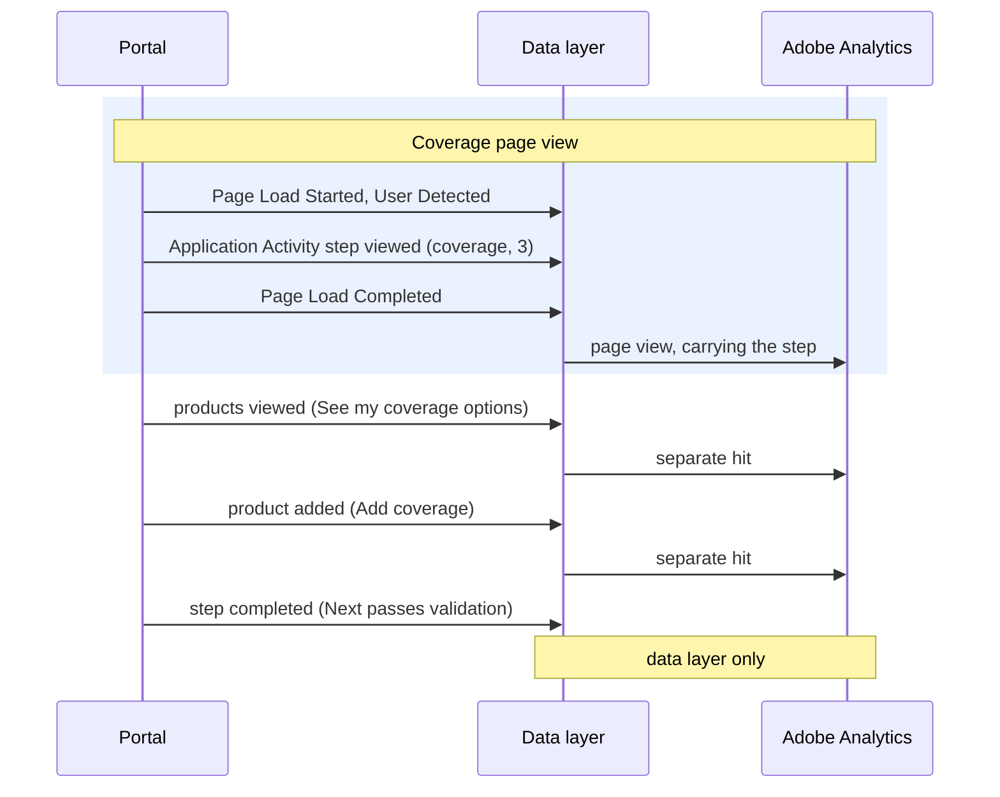

# Application Activity

[Back to the overview](../README.md) · Needed for your reports

**What it records:** progress through the quote and the insurance application, from the first
quote to the receipt, in one event. `application.action` says what happened. The products involved
sit inside the same object, in `application.product`.

The whole journey, page by page, is on [The application journey](../application-journey.md).

## The actions

**Needed for your reports:**

| Action | When | Feeds |
|---|---|---|
| `products-viewed` | "See my quote" (quote drawer or instant quote panel) or "See my coverage options" returns results. Once per search, when the results arrive. Holds every product returned | Product |
| `product-added` | A product enters the cart after Add or Add coverage. Holds the added product | Product |
| `started` | The first input on the Membership form. Once per application. Not on the Begin application click | Form Start |
| `step-viewed` | Every view of an application page, Membership to Signature, revisits included (marked as a repeat). With the page view | Eligibility, Coverage, Preview |
| `submitted` | The receipt page shows its confirmation number. Once per receipt number. With the page view. Holds every submitted product | Application Submit, Product |
| `advisor-confirmation-sent` | The advisor's "Application sent successfully" page. With the page view ([decision 7](../open-questions.md)) | Advisor Confirmation |
| `esign-started` | Next on the Signature page, as the visitor leaves for DocuSign ([decision 4](../open-questions.md)) | Signature, possibly |

**Recommended:**

| Action | When |
|---|---|
| `quote-started` | The first input in the quote drawer or the instant quote panel. Not when it opens |
| `product-removed` | Remove, in the coverage cart |
| `step-completed` | Next passes validation, Membership to Payment, just before the page changes. **Proposed**, and data layer only for now ([decision 9](../open-questions.md)) |
| `saved` | The first successful autosave, after Membership. Once per application |
| `resumed` | The first application page after a resume (code accepted, or Continue Application on the welcome-back page). With the page view |
| `knocked-out` | The first Membership answer is "not a member": the message shows and Next stays disabled. A second reason, an eligibility rule, is **Proposed** ([decision 17](../open-questions.md)) |

**Never recorded as Application Activity:** the Begin application click, a Next that fails
validation (that is a [Form Activity](form-activity.md) error), messages the system shows by
itself, a screen refreshing, answers on the profile, health, payment or beneficiary pages, and the
clicks listed under [Interaction](interaction.md).

## Example: one application page



The receipt page, two products submitted:

```js
window.appEventData.push({
  "event": "Application Activity",
  "application": {
    "action": "submitted",
    "channel": "self-service",
    "step": {
      "name": null,
      "group": null,
      "number": null,
      "repeat": null
    },
    "receiptId": "APP-12345678",
    "knockoutReason": null,
    "product": [
      {
        "productInfo": {
          "productID": "G-4120-1",
          "name": "Group Term Life",
          "category": "term-life",
          "underwritingClass": "si"
        },
        "quantity": 1,
        "quickDecisionEligible": true
      },
      {
        "productInfo": {
          "productID": "G-5210-1",
          "name": "Group Disability Income",
          "category": "disability",
          "underwritingClass": "di"
        },
        "quantity": 1,
        "quickDecisionEligible": false
      }
    ]
  }
});
```

The Eligibility step, before any coverage is chosen (on later steps, `product` holds the cart at that moment):

```js
window.appEventData.push({
  "event": "Application Activity",
  "application": {
    "action": "step-viewed",
    "channel": "self-service",
    "step": {
      "name": "eligibility",
      "group": "getting-started",
      "number": 2,
      "repeat": false
    },
    "receiptId": null,
    "knockoutReason": null,
    "product": []
  }
});
```

## Properties

All details are sent every time; a detail that does not apply is `null`, and `product` is `[]`
when no product is involved.

| Property | Required | What it holds | Values |
|---|---|---|---|
| `application.action` | yes | What happened (tables above) | `products-viewed`, `started`, ... |
| `application.channel` | yes | Who is completing the application | `self-service`, `advisor-assisted` |
| `application.step.name` | on step actions | The application page | `membership`, `eligibility`, `coverage`, `beneficiary`, `contact`, `profile`, `review`, the health pages, `payment`, `docusign` |
| `application.step.group` | with a step | The progress stage | `getting-started`, `coverage-options`, `profile`, `application-review`, `esign-submit` |
| `application.step.number` | with a step | The step's position in this application's flow | `1`, `2`, `3` ... |
| `application.step.repeat` | with a step | `true` when this step was already viewed for this application in this visit | `true`, `false` |
| `application.receiptId` | on submitted | The confirmation number on the receipt ([decision 15](../open-questions.md)) | `APP-12345678` |
| `application.knockoutReason` | on knocked out | Why the applicant was stopped | `not-member`; `eligibility-not-met` (Proposed) |
| `application.product` | yes | The products this event is about. See [Products](../reference/products.md) | a list, or `[]` |

## Key rules

1. **Recorded when the result happens, not on the click**: products viewed when the results
   arrive, submitted when the receipt shows.
2. **A reload never repeats a once-only action**: started and saved are remembered for the
   application, and submitted for the receipt number.
3. **Step views count every view**, revisits included, marked as a repeat. **Proposed**: Eligibility,
   Coverage and Preview in your reports then count views, not applicants.
4. **Signing at DocuSign cannot be measured**; the receipt is the only sign that it happened
   ([decision 18](../open-questions.md)).
5. **No amounts, premiums or answers**, ever. See [Privacy](../privacy.md).

## How to check it

1. Walk one application with test details. Each step shows a step viewed between Page Load Started
   and Page Load Completed.
2. Reload the Eligibility page: step viewed again with `repeat: true`; no second `started`.
3. Reload the receipt: no second `submitted`.
4. Each push has `event` and `application` only, and `application.product` is always a list.
