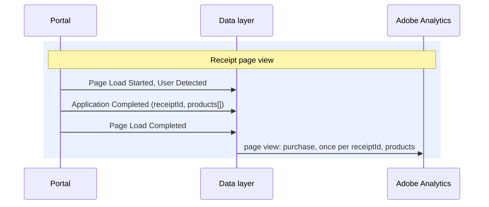

# Application Completed

**Event name:** `Application Completed` · Needed for your reports

[Back to the overview](../README.md)

> **Relationship to [Application Activity](application-activity.md).** Application Completed is a
> dedicated milestone that marks a submitted application. The detailed step-by-step journey stays
> on Application Activity; this event is the **back bookend** for completion rate, and the one
> place an Adobe **purchase** is recorded, with the submitted products on the product string. No
> price is sent ([Privacy](../privacy.md)), so the purchase counts orders, not revenue.

## What it answers

- How many applications are submitted: the numerator for every completion rate.
- The submit rate from start, by channel and association, over time.
- Which products are submitted, in what mix.
- Advisor vs. self-service completion.

The whole journey, page by page, is on [The application journey](../application-journey.md).

## When to fire it

- **Fire this once per application, when the receipt page shows its confirmation number.**
- **Fire it with the page view** (between User Detected and Page Load Completed), so it travels
  with the receipt page view.
- **Fire it on every experience the same way**, with or without the instant quote panel.
- **Never repeat it on a reload of the receipt.** Remember the submit against `receiptId`: one
  submit per `receiptId`.
- **Do not fire it for:** an e-sign start, a docusign step, or an advisor confirmation (that is its
  own event).

**Feeds your reports:** Application Submit (event77) and Order Page (event44), both counted once
per `receiptId` on this one hit. Today both fire on the Thank You page (event77 on the Decision page
in the quick-decision flow); the new template merges those pages, so both now count the same
submit and both report series continue ([decision 4](../open-questions.md), answered). Orders
and the product merchandising are Recommended, beyond your two reports.

## What a purchase needs in Adobe

This event is the application's **purchase**: the Adobe event that counts orders. For Adobe to
record it cleanly, the mapping has to cover each of these:

| Adobe needs | Source in this event | Why it matters |
|---|---|---|
| The `purchase` event | fired by this event | Marks the submit; drives Orders |
| `purchaseID` (order id) | `application.receiptId` | Deduplicates the order: a receipt reload must not double-count Orders |
| `products` string | `application.product[]` | One entry per submitted product, with the price slot left empty |
| Merchandising | `category`, `underwritingClass`, `quickDecisionEligible` | Let Orders break down by product attribute |

> **No price, no revenue.** A product's price and the selected benefit amount are not sent: they
> come from the applicant's own answers and could help identify them when combined with other
> data Adobe collects (agreed at the 2026-10-27 office hours). Revenue and average order value are
> not reported; benefit and price data for future reporting is [decision 30](../open-questions.md).

## Example

The receipt page view, two products submitted:



The submit travels with the receipt page view, is remembered per `receiptId`, and carries every
submitted product.

## Javascript code

```js
window.appEventData = window.appEventData || [];
window.appEventData.push({
  "event": "Application Completed",
  "application": {
    "channel": "<channel>",
    "applicationName": "<applicationName>",
    "applicationId": "<applicationId>",
    "receiptId": "<receiptId>",
    "product": [
      {
        "productInfo": {
          "productID": "<productID>",
          "name": "<productName>",
          "category": "<productCategory>",
          "underwritingClass": "<underwritingClass>"
        },
        "quantity": "<quantity>",
        "quickDecisionEligible": "<quickDecisionEligible>"
      }
    ]
  }
});
```

## Populated example

The receipt page, two products submitted:

```js
window.appEventData = window.appEventData || [];
window.appEventData.push({
  "event": "Application Completed",
  "application": {
    "channel": "self-service",
    "applicationName": "waepa-term-life",
    "applicationId": "4f9c2a7e1b83",
    "receiptId": "APP-12345678",
    "product": [
      {
        "productInfo": {
          "productID": "G-4120-1",
          "name": "Group Term Life",
          "category": "term-life",
          "underwritingClass": "si"
        },
        "quantity": 1,
        "quickDecisionEligible": true
      },
      {
        "productInfo": {
          "productID": "G-5210-1",
          "name": "Group Disability Income",
          "category": "disability",
          "underwritingClass": "di"
        },
        "quantity": 1,
        "quickDecisionEligible": false
      }
    ]
  }
});
```

## Variable definitions

All details are sent every time; a detail that does not apply is `null`.

| Path | Type | Description | Example |
|---|---|---|---|
| `application.channel` | string | Required. For your reports. Who completed the application | `self-service`, `advisor-assisted` |
| `application.applicationName` | string | Required. For your reports. The specific application being filled out (for example term life on the WAEPA portal); `channel` says who completes it. The list of values is [decision 23](../open-questions.md) | `waepa-term-life` |
| `application.applicationId` | string or null | Required. Recommended. The masked id of this application, the same on every application event from the moment it is created (agreed on 2026-10-23). The front end provides the masked value, never the database id (2026-10-27). When it is created and how it is masked is [decision 27](../open-questions.md) | `4f9c2a7e1b83` |
| `application.receiptId` | string | Required. The order id (`purchaseID`). Deduplicates the purchase; counts each application once | `APP-12345678` |
| `application.product` | array | Required. For your reports. Every submitted product; carried on the product string | a list |
| `application.product[n].productInfo.productID` | string | Required. Stable product id; the product-string identifier | `G-4120-1` |
| `application.product[n].productInfo.name` | string | Recommended. Product name as configured | `Group Term Life` |
| `application.product[n].productInfo.category` | string | Recommended. Product category; merchandising candidate | `term-life` |
| `application.product[n].productInfo.underwritingClass` | string or null | Recommended. Underwriting class; merchandising candidate | `si`, `gi` |
| `application.product[n].quantity` | integer | Recommended. Always `1`: it never counts people | `1` |
| `application.product[n].quickDecisionEligible` | boolean | Recommended. Quick-decision offered; merchandising candidate | `true`, `false` |

## How to check it

1. Submit one application with test details. **Application Completed** fires once, with the receipt
   page view, and records a purchase against `receiptId`.
2. Reload the receipt page: **no second purchase**: Orders do not move.
3. Submit a two-product application: both products appear on the product string, with no price,
   and the order is credited to **each** product.
4. Orders break down by `category`, `underwritingClass`, and `quickDecisionEligible`.
5. The start-to-submit funnel using [Application Started](application-started.md) and Application
   Complete returns a sane conversion rate, and holds up when split by `channel`.
