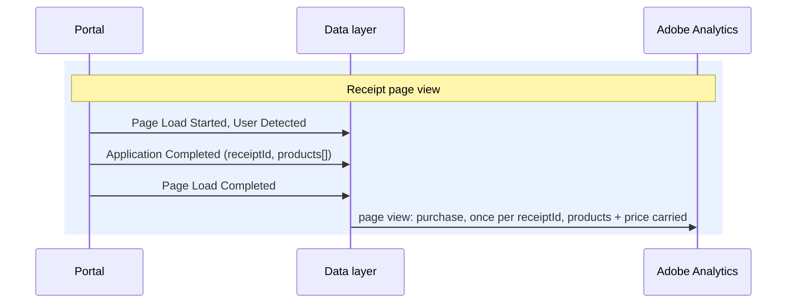

# Application Completed

**Event name:** `Application Completed` · Needed for your reports

[Back to the overview](../README.md)

> **Relationship to [Application Activity](application-activity.md).** Application Completed is a
> dedicated milestone that marks a submitted application. The detailed step-by-step journey stays
> on Application Activity; this event is the **back bookend** for completion rate, and the one
> place a proper Adobe **purchase** is recorded: with the submitted products and their price on
> the product string.

## What it answers

- How many applications are submitted: the numerator for every completion rate.
- The submit rate from start, by channel and association, over time.
- Which products are submitted, in what mix, and at what price: on the product string per product.
- Revenue and average order value, by product and channel.
- Advisor vs. self-service completion.

The whole journey, page by page, is on [The application journey](../application-journey.md).

## When to fire it

- **Fire this once per application, when the receipt page shows its confirmation number.**
- **Fire it with the page view** (between User Detected and Page Load Completed), so it travels
  with the receipt page view.
- **Fire it on every experience the same way**, with or without the instant quote panel.
- **Never repeat it on a reload of the receipt.** Remember the submit against `receiptId`: one
  submit per `receiptId`.
- **Do not fire it for:** an e-sign start, a docusign step, or an advisor confirmation (that is its
  own event).

**Feeds your reports:** Application Submit (event77), counted once per `receiptId`. The purchase,
orders and revenue are Recommended, beyond your two reports.

## What a purchase needs in Adobe

This event is the application's **purchase**. For Adobe to record it cleanly, the mapping has to
cover each of these:

| Adobe needs | Source in this event | Why it matters |
|---|---|---|
| The `purchase` event | fired by this event | Marks the conversion; drives Orders |
| `purchaseID` (order id) | `application.receiptId` | Deduplicates the order: a receipt reload must not double-count Orders or revenue |
| `products` string | `application.product[]` | One entry per submitted product, each carrying its price |
| Revenue | `productInfo.price.sellingPrice` | Goes in the product-string price slot; Adobe sums it across products (quantity is always `1`) |
| Base price | `productInfo.price.basePrice` | Carried as a separate currency event in product syntax, so base-vs-selling delta is reportable |
| `currencyCode` | USD assumed | Set only if a portal ever transacts in another currency |
| Merchandising | `category`, `underwritingClass`, `quickDecisionEligible` | Let Orders and revenue break down by product attribute |

> **Scope note.** `sellingPrice` and `basePrice` describe the **product**, not the applicant. No
> PII or personal answers are sent, so they are in scope for this event. See [Privacy](../privacy.md).

## Example

The receipt page view, two products submitted:



The submit travels with the receipt page view, is remembered per `receiptId`, and carries every
submitted product and its price onto the product string.

## Javascript code

```js
window.appEventData = window.appEventData || [];
window.appEventData.push({
  "event": "Application Completed",
  "application": {
    "channel": "<channel>",
    "applicationName": "<applicationName>",
    "receiptId": "<receiptId>",
    "product": [
      {
        "productInfo": {
          "productID": "<productID>",
          "name": "<productName>",
          "category": "<productCategory>",
          "underwritingClass": "<underwritingClass>",
          "benefitAmount": "<benefitAmount>",
          "price": {
            "basePrice": "<basePrice>",
            "sellingPrice": "<sellingPrice>"
          }
        },
        "quantity": "<quantity>",
        "quickDecisionEligible": "<quickDecisionEligible>"
      }
    ]
  }
});
```

## Populated example

The receipt page, two products submitted:

```js
window.appEventData = window.appEventData || [];
window.appEventData.push({
  "event": "Application Completed",
  "application": {
    "channel": "self-service",
    "applicationName": "waepa-term-life",
    "receiptId": "APP-12345678",
    "product": [
      {
        "productInfo": {
          "productID": "G-4120-1",
          "name": "Group Term Life",
          "category": "term-life",
          "underwritingClass": "si",
          "benefitAmount": 100000,
          "price": {
            "basePrice": 45.0,
            "sellingPrice": 39.99
          }
        },
        "quantity": 1,
        "quickDecisionEligible": true
      },
      {
        "productInfo": {
          "productID": "G-5210-1",
          "name": "Group Disability Income",
          "category": "disability",
          "underwritingClass": "di",
          "benefitAmount": 50000,
          "price": {
            "basePrice": 60.0,
            "sellingPrice": 52.5
          }
        },
        "quantity": 1,
        "quickDecisionEligible": false
      }
    ]
  }
});
```

## Variable definitions

All details are sent every time; a detail that does not apply is `null`.

| Path | Type | Description | Example |
|---|---|---|---|
| `application.channel` | string | Required. For your reports. Who completed the application | `self-service`, `advisor-assisted` |
| `application.applicationName` | string | Required. For your reports. The specific application being filled out (for example term life on the WAEPA portal); `channel` says who completes it. The list of values is [decision 23](../open-questions.md) | `waepa-term-life` |
| `application.receiptId` | string | Required. The order id. Deduplicates the purchase; counts each application once | `APP-12345678` |
| `application.product` | array | Required. For your reports. Every submitted product; carried on the product string | a list |
| `application.product[n].productInfo.productID` | string | Required. Stable product id; the product-string identifier | `G-4120-1` |
| `application.product[n].productInfo.name` | string | Recommended. Product name as configured | `Group Term Life` |
| `application.product[n].productInfo.category` | string | Recommended. Product category; merchandising candidate | `term-life` |
| `application.product[n].productInfo.underwritingClass` | string or null | Recommended. Underwriting class; merchandising candidate | `si`, `gi` |
| `application.product[n].productInfo.benefitAmount` | integer or null | Recommended. The selected coverage / benefit amount for this product: product information, the same as on Application Activity | `100000` |
| `application.product[n].productInfo.price.basePrice` | number | Recommended. The product's base price; carried as a currency event | `45.00` |
| `application.product[n].productInfo.price.sellingPrice` | number | Required for revenue. The price charged; the product-string price slot | `39.99` |
| `application.product[n].quantity` | integer | Recommended. Always `1`: it never counts people | `1` |
| `application.product[n].quickDecisionEligible` | boolean | Recommended. Quick-decision offered; merchandising candidate | `true`, `false` |

## How to check it

1. Submit one application with test details. **Application Completed** fires once, with the receipt
   page view, and records a purchase against `receiptId`.
2. Reload the receipt page: **no second purchase**: Orders and revenue do not move.
3. Submit a two-product application: both products appear on the product string, revenue equals the
   sum of their `sellingPrice`, and the purchase is credited to **each** product.
4. Orders and revenue break down by `category`, `underwritingClass`, and `quickDecisionEligible`.
5. The start-to-submit funnel using [Application Started](application-started.md) and Application
   Complete returns a sane conversion rate, and holds up when split by `channel`.
