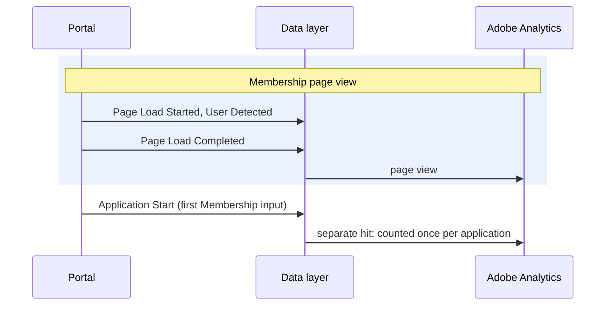

# Application Start

**Event name:** `Application Start` · Needed for your reports

[Back to the overview](../README.md)

> **Relationship to [Application Activity](application-activity.md).** Application Start is a
> dedicated milestone that marks the moment an application begins. The detailed step-by-step
> journey stays on Application Activity; this event is the **front bookend** for every completion
> rate, so "how many applications began" is a clean, deduped metric on its own.

## What it answers

- How many visitors begin an application: the denominator for every downstream completion rate.
- Where starts come from: self-service vs. advisor-assisted (`channel`), and which association.
- The start-to-submit conversion rate, paired with [Application Complete](application-complete.md).
- Whether a page or experience change moved the start rate, over time.

The whole journey, page by page, is on [The application journey](../application-journey.md).

**Feeds your reports:** Form Start (event12), once per application.

## When to fire it

- **Fire this once per application, on the first real input on the Membership form.** Not on the
  Begin application click, and not on the page view.
- **Fire it as its own hit.**
- **Fire it on every experience the same way**, with or without the instant quote panel
  ([the rule](../how-it-works.md#which-event-fires-where-the-two-landing-experiences)).
- **Never repeat it on a reload or revisit.** Remember the start for the application: one start
  per application.
- **Do not fire it for:** the Begin application click, a quote start, or a resumed application
  (that is [Application Activity](application-activity.md) `resumed`).
- **Never send PII or an applicant's answers**: no names, contact details, SSNs, dates of birth,
  health responses, or personal financial figures. Product-level values (a product's price and the
  selected coverage amount) are product information, not PII, and are sent. See [Privacy](../privacy.md).

## Example

The Membership page view, then the first input:



The start is its own hit, fired once, and remembered so a reload cannot count it twice.

## Javascript code

```js
window.appEventData = window.appEventData || [];
window.appEventData.push({
  "event": "Application Start",
  "application": {
    "channel": "<channel>",
    "applicationName": "<applicationName>"
  }
});
```

## Populated example

```js
window.appEventData = window.appEventData || [];
window.appEventData.push({
  "event": "Application Start",
  "application": {
    "channel": "self-service",
    "applicationName": "waepa-term-life"
  }
});
```

## Variable definitions

| Path | Type | Description | Example |
|---|---|---|---|
| `application.channel` | string | Required. For your reports. Who is completing the application | `self-service`, `advisor-assisted` |
| `application.applicationName` | string | Required. For your reports. The application the visitor is completing | `waepa-term-life` |

## How to check it

1. Begin one application with test details. **Application Start** fires once, as its own hit, at
   the first Membership input, not on the Begin application click.
2. Reload the Membership page and type again: **no second start**.
3. The start-to-submit funnel using Application Start and
   [Application Complete](application-complete.md) returns a sane conversion rate.
