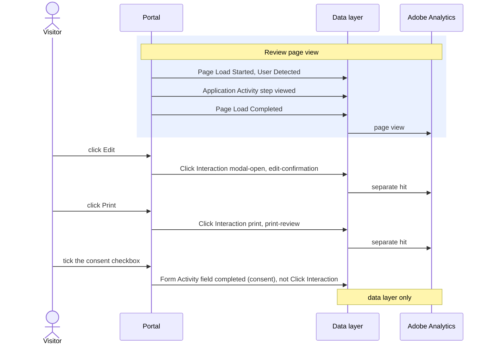

# Click Interaction

**Event name:** `Click Interaction` · Recommended; contact clicks may feed your reports ([decision 4](../open-questions.md))

[Back to the overview](../README.md)

## What it answers

- How many visitors ask for help: Chat now, Schedule a call, phone and email links.
- Which documents are downloaded or printed (the application PDF, the review page).
- Which information windows people open (How Applying Works, About Coverage, the Needs
  Calculator), and how they close them.
- Which links and buttons are used, and where on the page they sit.

## When to fire it

- **Fire this event when the visitor clicks a tracked control** ([full list below](#tracked-controls)):
  a mouse click, a tap, or Enter or Space on a focused button or link. One click, one event.
- **Also fire it when a listed window is closed with the Escape key or by clicking behind it.** These
  are not strictly clicks, but they stay here so window opens and closes are counted together;
  `element.type` is `key` or `backdrop`.
- **Fire it when the click happens**, before the click changes the page or closes the window.
- **Do not fire it for:**
  - controls whose result is recorded by another event: Begin application, Next and Back, Add
    coverage, Remove, See my quote, the signature Next, Continue on the resume pages;
  - form fields of any kind: text boxes, dropdowns, radio buttons, checkboxes, health answers;
  - Add Spouse, Add Child and the dependent-only confirmation (household make-up is never recorded,
    see [Privacy](../privacy.md));
  - messages the system shows by itself, the cookie banner, and anything inside the chat window,
    the scheduler or DocuSign;
  - any control not in the tracked list.
- **Use fixed text written in the code** for every value: never the page's text, a field's value,
  a name, an amount or a receipt number.

## Actions

`interaction.type` says what happened. These are all the interactions expected:

| `interaction.type` | Fire it when | `interaction.detail` | `interaction.element.type` |
|---|---|---|---|
| `click` | A tracked link or button is clicked and none of the types below applies | `internal` or `external` on a link; empty on a button | `link`, `button` |
| `contact` | Chat now, Schedule a call, a phone link or an email link is clicked | `chat-now`, `schedule-call`, `phone`, `email` | `button`, `link` |
| `download` | A document download is clicked | `pdf` | `button`, `link` |
| `print` | Print is clicked | empty | `button` |
| `modal-open` | A listed information window is opened | empty | `button`, `link` |
| `modal-close` | A listed window is closed: its close icon, a button whose only job is to close it, a click behind it, or the Escape key | `close-button`, `action`, `backdrop`, `escape` | `button`, `backdrop`, `key` |
| `accordion` | A section is expanded or collapsed | `expand` or `collapse`: what this click does | `accordion` |
| `tab` | A tab is selected | the id of the tab selected | `tab` |

**Purpose wins:** a control meant to download, print or contact takes that type, whatever it does
on screen. Schedule a call opens a window, but it is `contact`.

### Tracked controls

From the final design. Chat now and Schedule a call appear only on the associations that offer
them.

| Control | Type | Name | Detail | Element |
|---|---|---|---|---|
| Chat now | `contact` | `chat-now` | `chat-now` | `button` |
| Schedule a call | `contact` | `schedule-call` | `schedule-call` | `button` |
| Call for help, and phone links | `contact` | `call-for-help`, or the link's id | `phone` | `link` |
| Email links | `contact` | the link's id | `email` | `link` |
| Privacy Notice | `click` | `privacy-notice` | `external` | `link` |
| The association's website | `click` | `association-website` | `external` | `link` |
| Continue Application, in the menu | `click` | `continue-application` | `internal` | `link` |
| The menu button | `click` | `menu` | empty | `button` |
| Resend code, when resuming | `click` | `resend-code` | empty | `button` |
| How Applying Works, About Coverage, About QuickDecision, Needs Calculator | `modal-open` | the window's id | empty | `button` |
| "Learn more about the review process" | `modal-open` | `review-process` | empty | as built |
| The coverage cart badge | `modal-open` | `coverage-cart` | empty | `button` |
| Add Beneficiary | `modal-open` | `add-beneficiary` | empty | `button` |
| Edit, on the Review page | `modal-open` | `edit-confirmation` | empty | `button` |
| A window's close icon, its backdrop, the Escape key | `modal-close` | the window's id | `close-button`, `backdrop`, `escape` | `button`, `backdrop`, `key` |
| Print, on the Review page | `print` | `print-review` | empty | `button` |
| Application PDF, Payment PDF, on the receipt | `download` | `application-pdf`, `payment-pdf` | `pdf` | `button` |
| Product category tabs | `tab` | `product-category-tabs` | the category id | `tab` |

**Window ids:** `how-applying-works`, `about-coverage`, `about-quickdecision`, `needs-calculator`,
`review-process`, `coverage-cart`, `add-beneficiary`, `edit-confirmation`, `send-to-applicant`,
`tpa-member-verification`. Where the last two open is confirmed in the build
([decision 16](../open-questions.md)).

## Example

On the Review page:



Each click is its own hit, after the page view. Ticking a checkbox is form use, so it is never an
Click Interaction.

## Javascript code

```js
window.appEventData = window.appEventData || [];
window.appEventData.push({
  "event": "Click Interaction",
  "interaction": {
    "type": "<type>",
    "name": "<name>",
    "detail": "<detail>",
    "fileName": "<fileName>",
    "element": {
      "type": "<elementType>",
      "text": "<text>",
      "region": "<region>",
      "destination": "<destination>"
    }
  }
});
```

## Populated example

A click on the Privacy Notice in the footer:

```js
window.appEventData = window.appEventData || [];
window.appEventData.push({
  "event": "Click Interaction",
  "interaction": {
    "type": "click",
    "name": "privacy-notice",
    "detail": "external",
    "fileName": null,
    "element": {
      "type": "link",
      "text": "Privacy Notice",
      "region": "footer",
      "destination": "www.newyorklife.com/privacy"
    }
  }
});
```

The Escape key closes the coverage cart (no element is clicked, so `element.type` is `key`):

```js
window.appEventData = window.appEventData || [];
window.appEventData.push({
  "event": "Click Interaction",
  "interaction": {
    "type": "modal-close",
    "name": "coverage-cart",
    "detail": "escape",
    "fileName": null,
    "element": {
      "type": "key",
      "text": null,
      "region": "modal",
      "destination": null
    }
  }
});
```

## Variable definitions

All details are sent every time; a detail that does not apply is `null`.

| Path | Type | Description | Example |
|---|---|---|---|
| `interaction.type` | string | Required. What happened ([Actions](#actions)). `contact` may feed your reports; the rest is Recommended | `click`, `contact`, `download` |
| `interaction.name` | string | Required. A fixed id for the control. For a window opening or closing, the id of the window | `privacy-notice`, `chat-now`, `edit-confirmation` |
| `interaction.detail` | string or null | A finer label, from the fixed list for its type ([Actions](#actions)) | `external`, `phone`, `escape` |
| `interaction.fileName` | string or null | Required on downloads. A fixed label for the file, never its real name | `application-pdf`, `payment-pdf` |
| `interaction.element.type` | string | Required. The kind of element. `key` means a keyboard action; `backdrop` means the area behind a window | `link`, `button`, `tab`, `accordion`, `backdrop`, `key` |
| `interaction.element.text` | string or null | The control's label, written in the code, never read from the screen | `Privacy Notice`, `Chat now` |
| `interaction.element.region` | string or null | Where the element sits on the page | `header`, `hero`, `body`, `drawer`, `modal`, `footer` |
| `interaction.element.destination` | string or null | Links only. External link: host and path, with no `?` or `#` part. Internal link: the target page id. A phone number or email address is never sent | `www.newyorklife.com/privacy`, `resume` |

## How to check it

1. Click a few tracked controls: each adds one Click Interaction with all its details present.
2. Click into form fields and tick a checkbox: no Click Interaction.
3. Click the Privacy Notice: exactly one hit reaches Adobe, and `element.destination` has no `?`
   or `#`. Adobe's own automatic link tracking and Activity Map are turned off, so a click is never
   sent twice.
