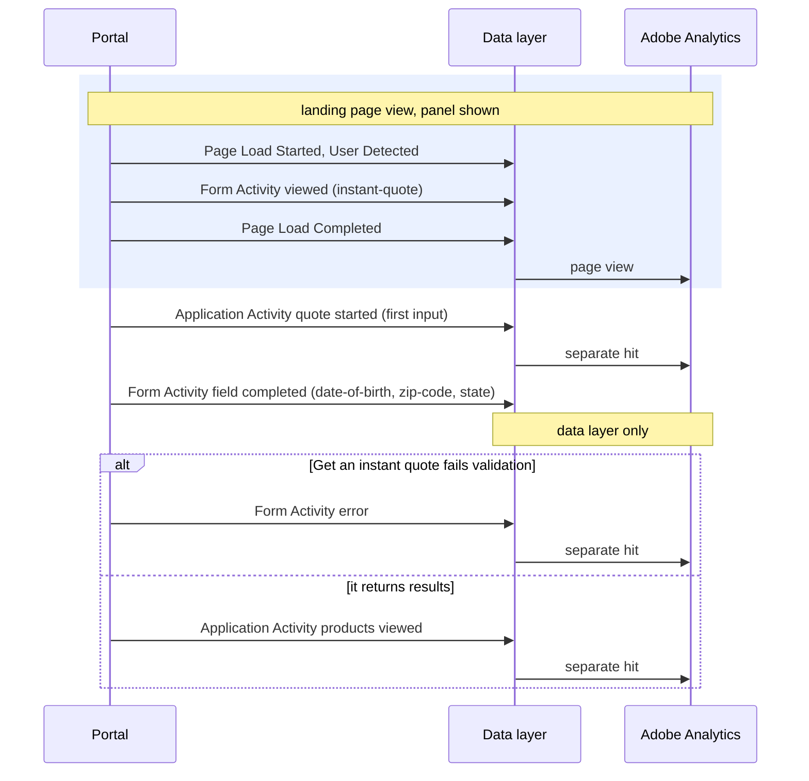

# Form Activity

[Back to the overview](../README.md) · Recommended; a successful advisor login may feed your reports ([decision 3](../open-questions.md))

**What it records:** how a form is used: shown, started, a step shown, a field completed, an
error, a success. Field names only, **never what was typed**.

## The four forms

| Form (`form.name`) | Where | What it records |
|---|---|---|
| `resume` | The three resume pages: email, method, code | everything: viewed, started, step viewed, field completed, error, succeeded |
| `advisor-login` | The advisor login page | everything except step viewed (one step) |
| `instant-quote` | The instant quote panel on the landing page, on the associations that show it | viewed, field completed and error only |
| `application` | Each application page, Membership to Payment | field completed and error only |

**Why the last two record less:** they are part of the quote and the application, so their start
and their result are progress, recorded by [Application Activity](application-activity.md)
("quote started" and "products viewed"; "started" and "submitted"). Nothing is counted twice
([the rule](../how-it-works.md#which-event-fires-where-the-two-landing-experiences)).

**Not forms:** the quote drawer (Application Activity only), the Needs Calculator (it has no
submit), Chat now and Schedule a call.

## The six actions

| Action (`form.action`) | When | Sent to Adobe |
|---|---|---|
| `viewed` | The form is shown: with the page view | yes, with the page view |
| `started` | The first input in any field. Never for the instant quote or the application | yes |
| `step-viewed` | A step of the resume form is shown | yes, with the page view |
| `field-completed` | A listed field is completed: its first change, then the visitor moves on. Once per field | **not yet**: data layer only ([decision 9](../open-questions.md)) |
| `error` | A submit is blocked by validation or rejected by the server. One per attempt, not per field | yes |
| `succeeded` | The server accepts the form: the resume code is verified, or the advisor login is accepted | yes |

## Examples

**The instant quote panel** (associations configured with it):



**Resuming an application:**


An error on the resume code step:

```js
window.appEventData.push({
  "event": "Form Activity",
  "form": {
    "action": "error",
    "name": "resume",
    "category": "resume",
    "step": { "name": "code", "number": 3 },
    "field": { "name": null, "section": null },
    "error": { "type": "submission", "code": "code-incorrect", "field": "verification-code" }
  }
});
```

## Properties

All details are sent every time; a detail that does not apply is `null`.

| Property | Required | What it holds | Values |
|---|---|---|---|
| `form.action` | yes | What happened (table above) | `viewed`, `started`, `step-viewed`, `field-completed`, `error`, `succeeded` |
| `form.name` | yes | Which form, by a fixed id | `resume`, `advisor-login`, `instant-quote`, `application` |
| `form.category` | yes | The kind of form | `resume`, `login`, `quote`, `application` |
| `form.step.name` | for the resume form and the application | The step or application page; empty for the one-step forms | `email`, `method`, `code`; `membership`, `eligibility` ... |
| `form.step.number` | with a step | The step's position | `1`, `2`, `3` |
| `form.field.name` | on field completed | **The field's name, never its value**, from the [form fields list](../reference/form-fields.md) ([decision 8](../open-questions.md)) | `zip-code`, `email` |
| `form.field.section` | yes | Empty in this version | `null` |
| `form.error.type` | on error | What kind of error | `validation`, `submission`, `system` |
| `form.error.code` | on error | The reason, from a fixed list, never the message text ([decision 19](../open-questions.md)) | `required-missing`, `invalid-format`, `code-incorrect`, `code-expired`, `no-match`, `service-unavailable` |
| `form.error.field` | on error, when the first field in error is listed | The first field in error, by name | `first-name`, `verification-code` |

## Key rules

1. **Never a value.** No date of birth, ZIP code, email, code or answer, and no error message text,
   which can repeat what was typed.
2. **The health pages report no error detail**: an error there is recorded with type, code and
   field all empty, because they could reveal an answer.
3. **Errors on the Eligibility page never name the field**, so they cannot reveal that a spouse or
   child was added.
4. **A change that records progress records nothing else**: the first Membership answer is
   "started", not also "field completed".

## How to check it

1. Resume with test details: viewed, step viewed for each step, started, succeeded.
2. Enter a wrong code: one error, with `code-incorrect`.
3. Search the browser console output for the test email you entered: it must not be found.
