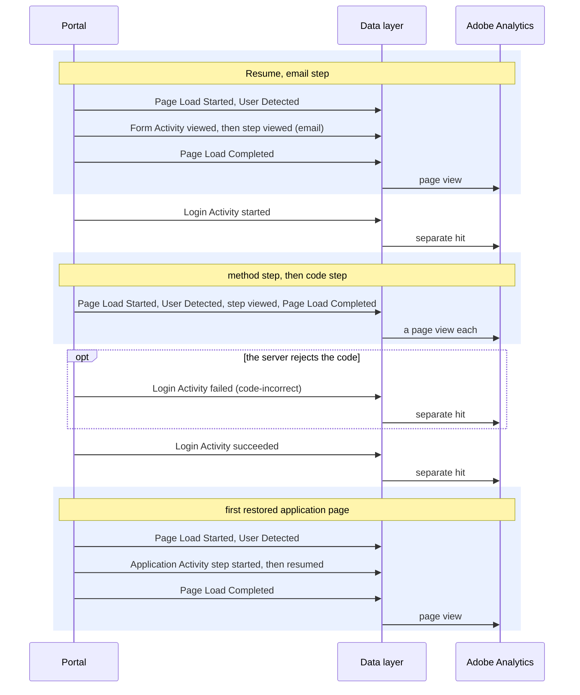

# Form Activity

**Event name:** `Form Activity` · Recommended

[Back to the overview](../README.md)

## What it answers

- How many people see each supplemental form (the resume and advisor login forms today, and a
  future form such as Contact Us), and how far they get through its steps.
- Where those forms fail: which step and which field cause errors, and why (a missing or badly
  formatted field), never what was typed.
- **Not the application or the quote:** form use there is
  [Application Activity](application-activity.md) (`field-completed` and `error`).
- Starts and outcomes are not here: they are a login ([Login Activity](login-activity.md)).

## When to fire it

- **Fire this event when one of the supplemental forms below is used:** it is shown, a step is shown, a
  field is completed, or a submit is blocked.
- **Report field names only**, from the [form fields list](../reference/form-fields.md). Never what
  was typed, and never error message text.
- **Never fire it inside the application or the quote** (the application pages, the instant quote
  panel, the quote drawer): that is [Application Activity](application-activity.md)
  ([the rule](../how-it-works.md#which-event-fires-where-the-two-landing-experiences)).
- **Never fire `started` or `succeeded` in this version.** The start and result of the resume and
  advisor login forms are [Login Activity](login-activity.md). Nothing is counted twice.
- **On the login and resume forms, `error` is only for problems caught before anything is sent**
  (a field empty or badly formatted). A wrong code or wrong credentials rejected by the server is
  Login Activity `failed`.
- **Do not fire it for:** the Needs Calculator (it has
  no submit), Chat now and Schedule a call (Click Interaction), Resend code (Click Interaction), a field the
  system fills by itself, or focus on a field without a change.

## Actions

`form.action` says what happened. These are all the actions expected:

| `form.action` | Fire it when | With the page view or its own hit | Sent to Adobe |
|---|---|---|---|
| `viewed` | The form is shown | with the page view | yes |
| `started` | Reserved for future forms; not used in this version | its own hit | yes |
| `step-viewed` | A step of the resume form is shown | with the page view | yes |
| `field-completed` | A listed field is completed: its first change, then the visitor moves on. Once per field | data layer only | **not yet** ([decision 9](../open-questions.md)) |
| `error` | A submit is blocked by validation before anything is sent. One per attempt, not per field | its own hit | yes |
| `succeeded` | Reserved for future forms; not used in this version | its own hit | yes |

**Which form records which action:**

| Form (`form.name`) | Where | `viewed` | `started` | `step-viewed` | `field-completed` | `error` | `succeeded` |
|---|---|---|---|---|---|---|---|
| `resume` | The three resume pages: email, method, code | yes | no: Login Activity `started` | yes | yes | before sending only; a rejected code is Login Activity `failed` | no: Login Activity `succeeded` |
| `advisor-login` | The advisor login page | yes | no: Login Activity `started` | no (one step) | yes | before sending only; rejected credentials are Login Activity `failed` | no: Login Activity `succeeded` |
| a future form, for example `contact-us` | Added to this specification before it is built | yes | yes, if it is no milestone | if it has steps | yes | yes | yes, if it is no milestone |

## Example

Resuming an application:



## Javascript code

```js
window.appEventData = window.appEventData || [];
window.appEventData.push({
  "event": "Form Activity",
  "form": {
    "action": "<action>",
    "name": "<name>",
    "category": "<category>",
    "step": {
      "name": "<stepName>",
      "number": "<stepNumber>"
    },
    "field": {
      "name": "<fieldName>",
      "section": "<fieldSection>"
    },
    "error": {
      "type": "<errorType>",
      "code": "<errorCode>",
      "field": "<errorField>"
    }
  }
});
```

## Populated example

The resume email step, submitted with the email left empty:

```js
window.appEventData = window.appEventData || [];
window.appEventData.push({
  "event": "Form Activity",
  "form": {
    "action": "error",
    "name": "resume",
    "category": "resume",
    "step": {
      "name": "email",
      "number": 1
    },
    "field": {
      "name": null,
      "section": null
    },
    "error": {
      "type": "validation",
      "code": "required-missing",
      "field": "email"
    }
  }
});
```

## Variable definitions

All details are sent every time; a detail that does not apply is `null`.

| Path | Type | Description | Example |
|---|---|---|---|
| `form.action` | string | Required. What happened ([Actions](#actions)) | `viewed`, `step-viewed`, `field-completed`, `error`; `started` and `succeeded` reserved |
| `form.name` | string | Required. Which form, by a fixed id | `resume`, `advisor-login`; a future form, for example `contact-us` |
| `form.category` | string | Required. The kind of form | `resume`, `login`; for example `contact` |
| `form.step.name` | string or null | Required for the resume form. The step; empty for the one-step forms | `email`, `method`, `code` |
| `form.step.number` | integer or null | Required with a step. The step's position | `1`, `2`, `3` |
| `form.field.name` | string or null | Required on `field-completed`. **The field's name, never its value**, from the [form fields list](../reference/form-fields.md) ([decision 8](../open-questions.md)) | `email`, `verification-code` |
| `form.field.section` | string or null | Empty in this version | `null` |
| `form.error.type` | string or null | Required on `error`. What kind of error | `validation`, `submission`, `system` |
| `form.error.code` | string or null | Required on `error`. The reason, from a fixed list, never the message text ([decision 19](../open-questions.md)) | `required-missing`, `invalid-format`, `service-unavailable` |
| `form.error.field` | string or null | On `error`, when the first field in error is listed. Its name only | `email`, `verification-code` |

## How to check it

1. Resume with test details: viewed, then step viewed for each step; no Form Activity `started`
   or `succeeded` (those are [Login Activity](login-activity.md)).
2. Submit the email step empty: one error, with `required-missing`. A wrong code is a Login
   Activity `failed`, never a Form Activity error.
3. Walk the application and, on an association that shows it, the instant quote panel: no Form
   Activity fires there.
4. Search the browser console output for the test email you entered: it must not be found.
