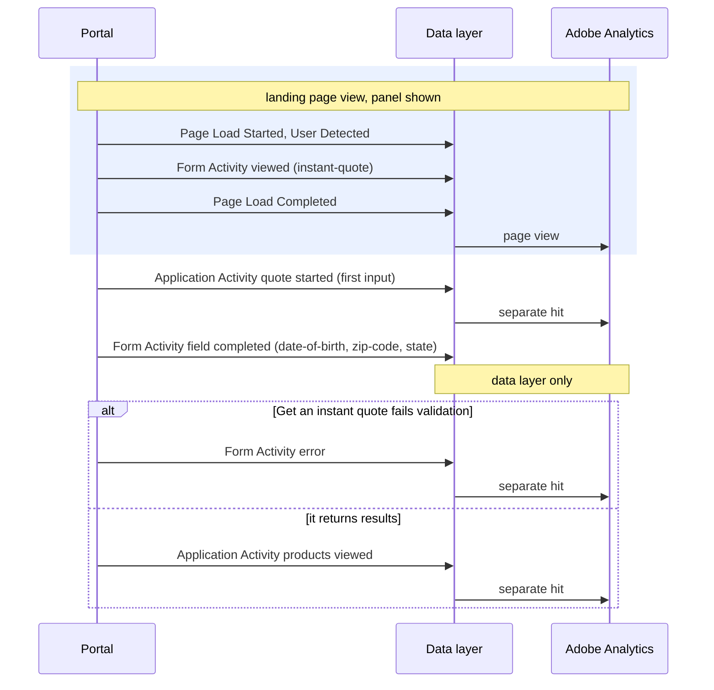

# Form Activity

**Event name:** `Form Activity` · Recommended; a successful advisor login may feed your reports ([decision 3](../open-questions.md))

[Back to the overview](../README.md)

## What it answers

- How many people see a form, start it, and complete it.
- Where forms fail: which step and which field cause errors, and why (a missing field, a wrong
  code), never what was typed.
- How many consumers resume an application, and how many advisors log in.
- How the instant quote panel is used on the associations that show it.

## When to fire it

- **Fire this event when one of the four forms below changes state:** it is shown, a step is shown,
  a field is first used or completed, a submit is blocked, or the server accepts the form.
- **Report field names only**, from the [form fields list](../reference/form-fields.md). Never what
  was typed, and never error message text.
- **For the instant quote panel and the application, fire only `viewed` (panel only),
  `field-completed` and `error`.** Their start and their result are progress, recorded by
  [Application Activity](application-activity.md); nothing is counted twice
  ([the rule](../how-it-works.md#which-event-fires-where-the-two-landing-experiences)).
- **Do not fire it for:** the quote drawer (Application Activity only), the Needs Calculator (it has
  no submit), Chat now and Schedule a call (Interaction), Resend code (Interaction), a field the
  system fills by itself, or focus on a field without a change.
- **A change that records progress records nothing else:** the first Membership answer is
  Application Activity "started", not also "field completed".

## Actions

`form.action` says what happened. These are all the actions expected:

| `form.action` | Fire it when | With the page view or its own hit | Sent to Adobe |
|---|---|---|---|
| `viewed` | The form is shown | with the page view | yes |
| `started` | The first input in any field of the form | its own hit | yes |
| `step-viewed` | A step of the resume form is shown | with the page view | yes |
| `field-completed` | A listed field is completed: its first change, then the visitor moves on. Once per field | data layer only | **not yet** ([decision 9](../open-questions.md)) |
| `error` | A submit is blocked by validation or rejected by the server. One per attempt, not per field | its own hit | yes |
| `succeeded` | The server accepts the form: the resume code is verified, or the advisor login is accepted | its own hit | yes |

**Which form records which action:**

| Form (`form.name`) | Where | `viewed` | `started` | `step-viewed` | `field-completed` | `error` | `succeeded` |
|---|---|---|---|---|---|---|---|
| `resume` | The three resume pages: email, method, code | yes | yes | yes | yes | yes | yes |
| `advisor-login` | The advisor login page | yes | yes | no (one step) | yes | yes | yes |
| `instant-quote` | The instant quote panel on the landing page, on the associations that show it | yes | no: Application Activity `quote-started` | no | yes | yes | no: Application Activity `products-viewed` |
| `application` | Each application page, Membership to Payment | no: Application Activity `step-viewed` | no: Application Activity `started` | no | yes | yes | no: Application Activity `submitted` |

## Example

The instant quote panel, on an association that shows it:



Resuming an application:


## Javascript code

```js
window.appEventData = window.appEventData || [];
window.appEventData.push({
  "event": "Form Activity",
  "form": {
    "action": "<action>",
    "name": "<name>",
    "category": "<category>",
    "step": {
      "name": "<stepName>",
      "number": "<stepNumber>"
    },
    "field": {
      "name": "<fieldName>",
      "section": "<fieldSection>"
    },
    "error": {
      "type": "<errorType>",
      "code": "<errorCode>",
      "field": "<errorField>"
    }
  }
});
```

## Populated example

A wrong code on the resume code step:

```js
window.appEventData = window.appEventData || [];
window.appEventData.push({
  "event": "Form Activity",
  "form": {
    "action": "error",
    "name": "resume",
    "category": "resume",
    "step": {
      "name": "code",
      "number": 3
    },
    "field": {
      "name": null,
      "section": null
    },
    "error": {
      "type": "submission",
      "code": "code-incorrect",
      "field": "verification-code"
    }
  }
});
```

## Variable definitions

All details are sent every time; a detail that does not apply is `null`.

| Path | Type | Description | Example |
|---|---|---|---|
| `form.action` | string | Required. What happened ([Actions](#actions)) | `viewed`, `started`, `step-viewed`, `field-completed`, `error`, `succeeded` |
| `form.name` | string | Required. Which form, by a fixed id | `resume`, `advisor-login`, `instant-quote`, `application` |
| `form.category` | string | Required. The kind of form | `resume`, `login`, `quote`, `application` |
| `form.step.name` | string or null | Required for the resume form and the application. The step or application page; empty for the one-step forms | `email`, `method`, `code`; `membership`, `eligibility` |
| `form.step.number` | integer or null | Required with a step. The step's position | `1`, `2`, `3` |
| `form.field.name` | string or null | Required on `field-completed`. **The field's name, never its value**, from the [form fields list](../reference/form-fields.md) ([decision 8](../open-questions.md)) | `zip-code`, `email` |
| `form.field.section` | string or null | Empty in this version | `null` |
| `form.error.type` | string or null | Required on `error`. What kind of error. Empty on the health pages, where it could reveal an answer | `validation`, `submission`, `system` |
| `form.error.code` | string or null | Required on `error`. The reason, from a fixed list, never the message text ([decision 19](../open-questions.md)). Empty on the health pages | `required-missing`, `invalid-format`, `code-incorrect`, `code-expired`, `no-match`, `service-unavailable` |
| `form.error.field` | string or null | On `error`, when the first field in error is listed. Its name only. Always empty on Eligibility, so it cannot reveal that a spouse or child was added | `first-name`, `verification-code` |

## How to check it

1. Resume with test details: viewed, step viewed for each step, started, succeeded.
2. Enter a wrong code: one error, with `code-incorrect`.
3. On an association with the instant quote panel: `viewed` with the landing page view, then
   Application Activity "quote started" on the first input, never Form Activity "started".
4. Search the browser console output for the test email you entered: it must not be found.
