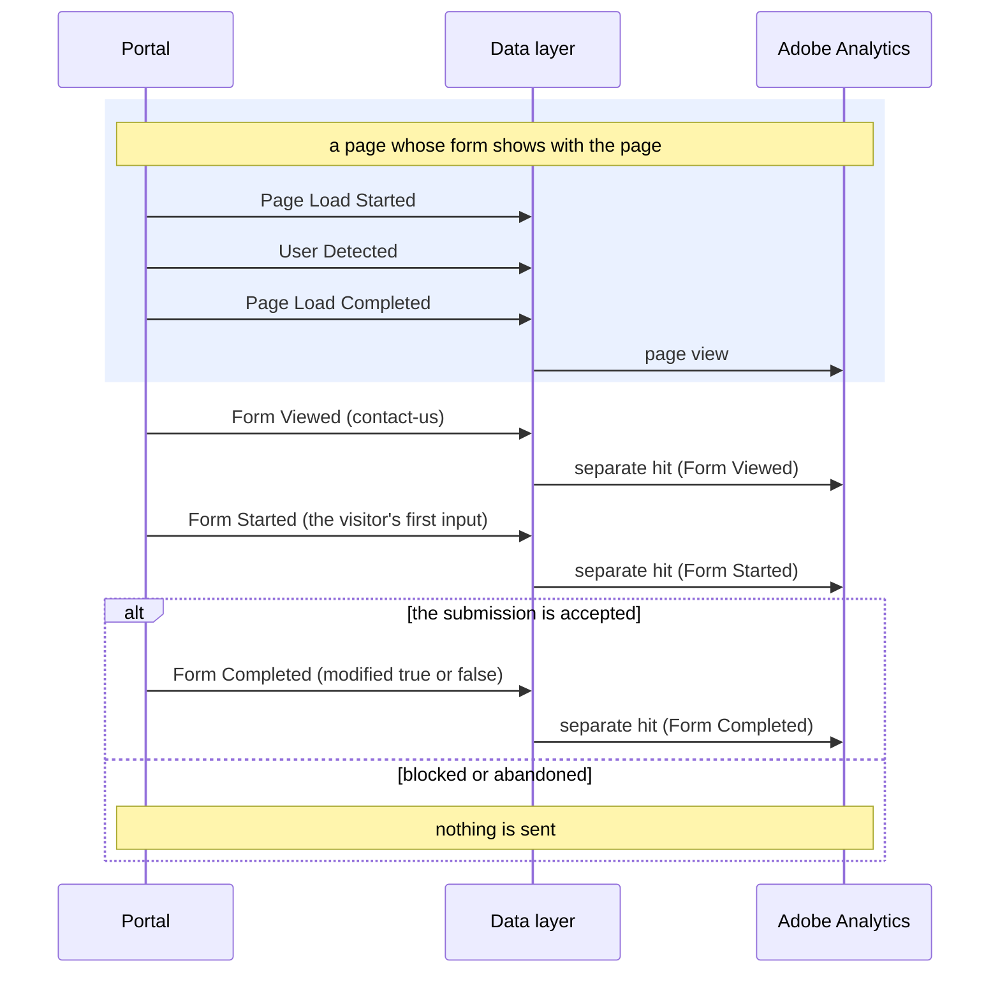

# Form Completed

**Event name:** `Form Completed` · Recommended

[Back to the overview](../README.md)

> **The three form events.** Form Viewed, Form Started and Form Completed describe **engagement
> forms**: a form that keeps a visitor in touch with you, such as the contact form after Chat now.
> They replace the earlier Form Activity event and carry no field-level detail (agreed at the
> 2026-10-23 office hours). The application and the quote are recorded by the
> [application events](application-activity.md); the resume and advisor login forms by
> [Login Activity](login-activity.md). Which engagement forms the portal has is
> [decision 26](../open-questions.md); `contact-us` is the working example.

## What it answers

- How many engagement forms are completed, and the completion rate from viewed and from started.
- Whether visitors sent a pre-filled form as it was, or changed it first.

## When to fire it

- **Fire this event when the submission is accepted**, when the form's success message shows.
  Once each time the form is shown, as its own hit.
- **Not** on the click on Submit: a submit that is blocked or rejected sends nothing.
- **`form.modified`** says whether the visitor changed anything before sending (agreed on
  2026-10-23).
- **Never send what was typed:** no field names, no values, no error text. See
  [Privacy](../privacy.md).
- **Do not fire it for:** the application or the quote, the resume and advisor login forms, the
  Needs Calculator (it has no submit), or Chat now and Schedule a call themselves (those are
  [Click Interaction](click-interaction.md)).

## Example



## Javascript code

```js
window.appEventData = window.appEventData || [];
window.appEventData.push({
  "event": "Form Completed",
  "form": {
    "name": "<formName>",
    "category": "<formCategory>",
    "prefilled": "<formPrefilled>",
    "modified": "<formModified>"
  }
});
```

## Populated example

The visitor sends the contact form, which opened empty:

```js
window.appEventData = window.appEventData || [];
window.appEventData.push({
  "event": "Form Completed",
  "form": {
    "name": "contact-us",
    "category": "contact",
    "prefilled": false,
    "modified": true
  }
});
```

## Variable definitions

All details are sent every time; a detail that does not apply is `null`. The same details go on
Form Viewed, Form Started and Form Completed.

| Path | Type | Description | Example |
|---|---|---|---|
| `form.name` | string | Required. Which form, by a fixed id. The list is [decision 26](../open-questions.md) | `contact-us` |
| `form.category` | string | Required. The kind of engagement form | `contact` |
| `form.prefilled` | boolean | Required. `true` when the form opened with values the portal filled in itself; says that values were there, never which | `true`, `false` |
| `form.modified` | boolean or null | Required. On Form Completed: `true` when the visitor entered or changed at least one value, `false` when the form was sent exactly as it opened (only possible when `prefilled` is `true`). Empty on Form Viewed and Form Started | `true`, `false`, `null` |

## How to check it

1. Send the contact form with test details: one Form Completed with `modified: true`.
2. Submit with a required field empty: nothing is sent.
3. Search the browser console output for what you typed: it must not be found.
