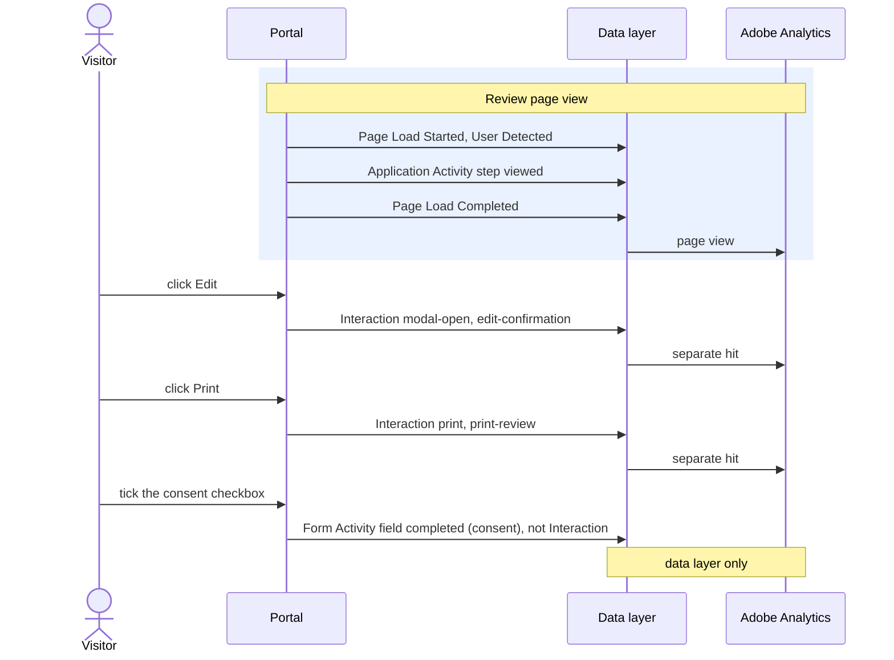

# Interaction

[Back to the overview](../README.md) · Contact clicks may feed your reports ([decision 4](../open-questions.md)); everything else is Recommended

**What it records:** a click on a tracked link or button, in one event with two parts:
- **what happened** (`interaction`): a click, a contact, a download, a print, a window opening or
  closing, an accordion or a tab;
- **which element, and where** (`interaction.element`): a link or a button, its label, where it
  sits on the page, and where a link goes.

## When to add it

- **A click on a tracked control** ([list below](#tracked-controls)): a mouse click, a tap, or Enter
  or Space on a focused button or link. One click, one event.
- **A listed window closed with the Escape key or by clicking behind it** is also recorded.
- **Added when the click happens**, before the click changes the page or closes the window.
- **Not recorded:**
  - controls whose result is recorded by another event: Begin application, Next and Back,
    Add coverage, Remove, See my quote, the signature Next, Continue on the resume pages;
  - form fields of any kind: text boxes, dropdowns, radio buttons, checkboxes, health answers;
  - Add Spouse and Add Child, and the dependent-only confirmation (household make-up is never
    recorded, see [Privacy](../privacy.md));
  - messages the system shows by itself, the cookie banner, and anything inside the chat window,
    the scheduler or DocuSign;
  - any control not in the tracked list.

## Example: on the Review page



A click on an external link:

```js
window.appEventData.push({
  "event": "Interaction",
  "interaction": {
    "type": "click",
    "name": "privacy-notice",
    "detail": "external",
    "fileName": null,
    "element": {
      "type": "link",
      "text": "Privacy Notice",
      "region": "footer",
      "destination": "www.newyorklife.com/privacy"
    }
  }
});
```

Chat now:

```js
window.appEventData.push({
  "event": "Interaction",
  "interaction": {
    "type": "contact",
    "name": "chat-now",
    "detail": "chat-now",
    "fileName": null,
    "element": {
      "type": "button",
      "text": "Chat now",
      "region": "body",
      "destination": null
    }
  }
});
```

The Escape key closes the coverage cart (no element is clicked):

```js
window.appEventData.push({
  "event": "Interaction",
  "interaction": {
    "type": "modal-close",
    "name": "coverage-cart",
    "detail": "escape",
    "fileName": null,
    "element": {
      "type": "key",
      "text": null,
      "region": "modal",
      "destination": null
    }
  }
});
```

## Properties

All details are sent every time; a detail that does not apply is `null`.

**What happened** (`interaction`):

| Property | Required | What it holds | Values |
|---|---|---|---|
| `interaction.type` | yes | What happened. **Purpose wins:** a control meant to download, print or contact takes that type, whatever it does on screen | `click`, `contact`, `download`, `print`, `modal-open`, `modal-close`, `accordion`, `tab` |
| `interaction.name` | yes | A fixed id for the control. For a window opening or closing, the id of the window | `privacy-notice`, `chat-now`, `edit-confirmation` |
| `interaction.detail` | no | A finer label, from a fixed list per type (below) | `external`, `phone`, `escape` |
| `interaction.fileName` | for downloads | A fixed label for the file, never its real name | `application-pdf`, `payment-pdf` |

**Which element, and where** (`interaction.element`):

| Property | Required | What it holds | Values |
|---|---|---|---|
| `interaction.element.type` | yes | The kind of element. `key` means a keyboard action; `backdrop` means the area behind a window | `link`, `button`, `tab`, `accordion`, `backdrop`, `key` |
| `interaction.element.text` | no | The control's label, written in the code, never read from the screen | `Privacy Notice`, `Chat now` |
| `interaction.element.region` | no | Where the element sits on the page | `header`, `hero`, `body`, `drawer`, `modal`, `footer` |
| `interaction.element.destination` | no | Links only. External link: host and path, no `?` or `#` part. Internal link: the target page id | `www.newyorklife.com/privacy`, `resume` |

**Detail by type:**

| Type | Detail |
|---|---|
| `click` | `internal` or `external` on a link; empty on a button |
| `contact` | `chat-now`, `schedule-call`, `phone`, `email` |
| `modal-close` | `close-button`, `backdrop`, `escape`, `action` (a button whose only job is to close the window) |
| `accordion` | `expand` or `collapse`: what this click does |
| `tab` | the id of the tab selected |
| `download` | `pdf` |
| `print`, `modal-open` | empty |

## Tracked controls

From the final design. Chat now and Schedule a call appear only on the associations that offer
them.

| Control | Type | Name | Detail | Element |
|---|---|---|---|---|
| Chat now | `contact` | `chat-now` | `chat-now` | `button` |
| Schedule a call | `contact` | `schedule-call` | `schedule-call` | `button` |
| Call for help, and phone links | `contact` | `call-for-help`, or the link's id | `phone` | `link` |
| Email links | `contact` | the link's id | `email` | `link` |
| Privacy Notice | `click` | `privacy-notice` | `external` | `link` |
| The association's website | `click` | `association-website` | `external` | `link` |
| Continue Application, in the menu | `click` | `continue-application` | `internal` | `link` |
| The menu button | `click` | `menu` | empty | `button` |
| Resend code, when resuming | `click` | `resend-code` | empty | `button` |
| How Applying Works, About Coverage, About QuickDecision, Needs Calculator | `modal-open` | the window's id | empty | `button` |
| "Learn more about the review process" | `modal-open` | `review-process` | empty | as built |
| The coverage cart badge | `modal-open` | `coverage-cart` | empty | `button` |
| Add Beneficiary | `modal-open` | `add-beneficiary` | empty | `button` |
| Edit, on the Review page | `modal-open` | `edit-confirmation` | empty | `button` |
| A window's close icon, its backdrop, the Escape key | `modal-close` | the window's id | `close-button`, `backdrop`, `escape` | `button`, `backdrop`, `key` |
| Print, on the Review page | `print` | `print-review` | empty | `button` |
| Application PDF, Payment PDF, on the receipt | `download` | `application-pdf`, `payment-pdf` | `pdf` | `button` |
| Product category tabs | `tab` | `product-category-tabs` | the category id | `tab` |

**Window ids:** `how-applying-works`, `about-coverage`, `about-quickdecision`, `needs-calculator`,
`review-process`, `coverage-cart`, `add-beneficiary`, `edit-confirmation`, `send-to-applicant`,
`tpa-member-verification`. Where the last two open is confirmed in the build
([decision 16](../open-questions.md)).

## Key rules

1. **Values are fixed text written in the code.** Never the page's text, never a field's value,
   never a name, an amount or a receipt number.
2. **One click, one event.** A tracked control inside another records only the inner one.
3. **Adobe's own automatic link tracking and Activity Map are turned off** in Adobe Launch, so a
   click is never sent twice and no visible text is collected.
4. **A phone number or email address is never sent**: phone and email links are `contact`, with no
   destination.

## How to check it

1. Click a few tracked controls: each adds one Interaction with all its details present.
2. Click into form fields and tick a checkbox: no Interaction.
3. Click the Privacy Notice: exactly one hit reaches Adobe, and `element.destination` has no `?`
   or `#`.
