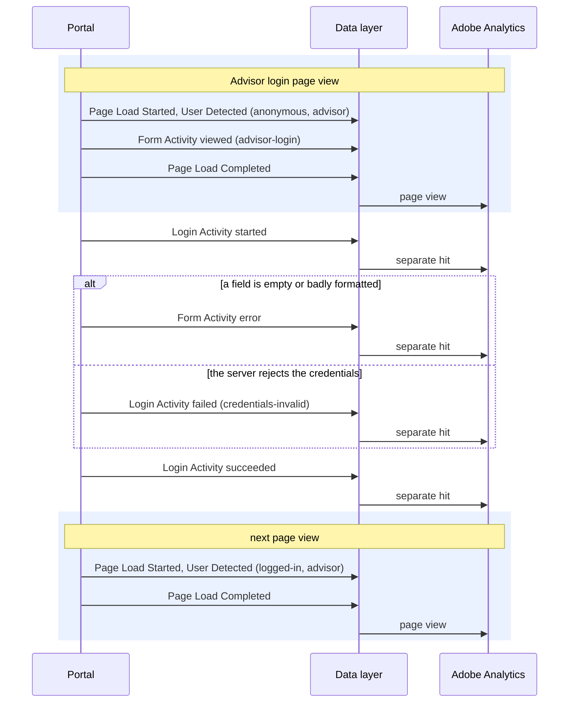

# Login Activity

**Event name:** `Login Activity` · Recommended; a successful login may feed your reports ([decision 3](../open-questions.md))

[Back to the overview](../README.md)

## What it answers

- How many advisors log in, and how many consumers verify their identity to resume an
  application.
- How many login attempts are rejected, and why (a wrong code, an expired code, wrong
  credentials), never what was typed.
- How many visits with a login go on to submit an application.
- Never who logged in: no name, email or phone number. A proposed anonymous id stays empty until
  New York Life approves it ([decision 20](../open-questions.md)).

## When to fire it

- **Fire this event at each step of an identity check:**
  - the advisor login, by email, phone and access code;
  - the consumer's resume check, by email and a verification code.
- **Fire `started`** on the first input in the login form, or in the resume form's first step.
- **Fire `succeeded`** when the server accepts the login or verifies the code, once, when the
  answer arrives.
- **Fire `failed`** each time the server rejects the credentials or the code.
- **Fire `logged-out`** when an advisor logs out, if the portal has a log out.
- **Do not fire it for:**
  - a field left empty or badly formatted before anything is sent to the server: that is a
    [Form Activity](form-activity.md) error;
  - Continue Application on the welcome-back page (there is no identity check);
  - Resend code (an [Interaction](interaction.md)).
- **The visitor's status changes on the next page, not this one.** The hit that records the
  success still shows the old status; the next page's [User Detected](user-detected.md) shows the
  new one.

## Actions

`login.action` says what happened. These are all the actions expected:

| `login.action` | Fire it when | Sent to Adobe |
|---|---|---|
| `started` | The first input in the advisor login form, or in the resume form's first step | yes, its own hit |
| `succeeded` | The server accepts the advisor login, or verifies the resume code | yes, its own hit |
| `failed` | The server rejects the credentials or the code. Once per attempt | yes, its own hit |
| `logged-out` | An advisor logs out | yes, its own hit |

## Example

The advisor login:



A rejected attempt is recorded once, as an error before it reaches the server, or as a failed
login after. The new login status appears from the next page on.

## Javascript code

```js
window.appEventData = window.appEventData || [];
window.appEventData.push({
  "event": "Login Activity",
  "login": {
    "action": "<action>",
    "method": "<method>",
    "userType": "<userType>",
    "failureReason": "<failureReason>",
    "id": "<id>"
  }
});
```

## Populated example

A consumer enters a wrong verification code:

```js
window.appEventData = window.appEventData || [];
window.appEventData.push({
  "event": "Login Activity",
  "login": {
    "action": "failed",
    "method": "email-code",
    "userType": "consumer",
    "failureReason": "code-incorrect",
    "id": null
  }
});
```

## Variable definitions

All details are sent every time; a detail that does not apply is `null`.

| Path | Type | Description | Example |
|---|---|---|---|
| `login.action` | string | Required. What happened ([Actions](#actions)). `succeeded` may feed your login success count ([decision 3](../open-questions.md)) | `started`, `succeeded`, `failed`, `logged-out` |
| `login.method` | string | Required. How the identity is checked: credentials for the advisor login, an email and code for the consumer resume | `credentials`, `email-code` |
| `login.userType` | string | Required. Who is logging in | `advisor`, `consumer` |
| `login.failureReason` | string or null | Required on `failed`. Why the server rejected the attempt, from a fixed list, never the message text ([decision 19](../open-questions.md)) | `credentials-invalid`, `code-incorrect`, `code-expired`, `no-match`, `service-unavailable` |
| `login.id` | string or null | Proposed. An anonymous id issued by New York Life's systems, never a name, email, phone number or policy number. **Empty until New York Life approves it** ([decision 20](../open-questions.md)) | `null` |

## How to check it

1. On the advisor login, type in a field: one `started`. Submit with a field empty: one Form
   Activity error, no Login Activity. Submit wrong credentials: one `failed`. Log in: one
   `succeeded`.
2. Resume with a test email: a wrong code gives one `failed` with `code-incorrect`; the right code
   gives one `succeeded`. The next page's User Detected shows `verified`.
3. Search the browser console output for the test email and code: neither may be found.
