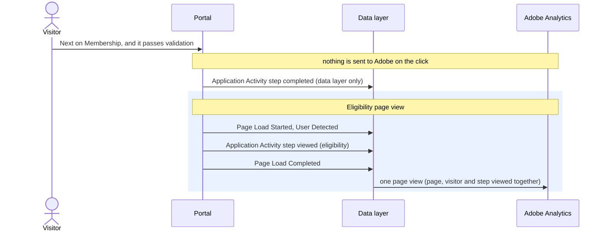

# Page Load Completed

[Back to the overview](../README.md) · Needed for your reports

**What it records:** the page view is complete. It carries no details of its own. When Adobe
Launch sees it, it sends **one page view** to Adobe Analytics, carrying the page details, the
visitor details and every event that described the page.

## When to add it

- **Once per page view, last:** exactly one for each [Page Load Started](page-load-started.md),
  after the new page or step is on screen, not when the change starts.
- The next page's Page Load Started comes only after this one.

## Example: moving from Membership to Eligibility



```js
window.appEventData.push({
  "event": "Page Load Completed"
});
```

## Key rules

1. **Exactly one per page view.** A missing one loses the page view; a second one doubles it.
2. **Events the visitor causes after this point are separate hits**, never part of the page view.
3. **The return from DocuSign to the receipt is a new page load**, so it starts again with Page
   Load Started.

## How to check it

1. `appEventData.map(e => e.event)` shows Page Load Started, User Detected, any page events, then
   Page Load Completed, for every page and step.
2. In the Adobe debugger, each page view is one hit, and the step viewed or submitted travels on
   it.
