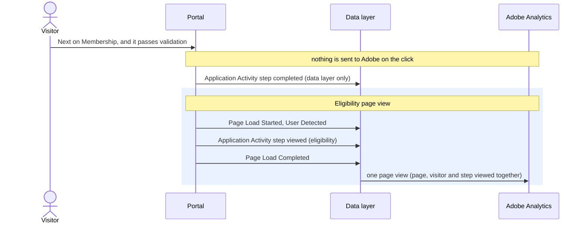

# Page Load Completed

**Event name:** `Page Load Completed` · Needed for your reports

[Back to the overview](../README.md)

## What it answers

- How many page views each page and step gets, counted once each.
- Which steps of the application were viewed, because the step travels with the page view.

## When to fire it

- **Fire this event last on every page view:** exactly one for each
  [Page Load Started](page-load-started.md), once the new page or step is on screen, not when the
  change starts.
- **The next page's Page Load Started comes only after this one.**
- **When Adobe Launch sees it, it sends one page view** to Adobe Analytics, carrying the page
  details, the visitor details and every event that described the page.
- **Events the visitor causes after this point are separate hits**, never part of the page view.
- **The return from DocuSign to the receipt is a new page load**, so it starts again with Page
  Load Started.

## Example

Moving from Membership to Eligibility:



The click itself sends nothing. Page Load Completed closes the Eligibility page view, and the step
viewed travels on it.

## Javascript code

The event has no details of its own:

```js
window.appEventData = window.appEventData || [];
window.appEventData.push({
  "event": "Page Load Completed"
});
```

## Populated example

The same push on every page and step:

```js
window.appEventData = window.appEventData || [];
window.appEventData.push({
  "event": "Page Load Completed"
});
```

## Variable definitions

| Path | Type | Description | Example |
|---|---|---|---|
| `event` | string | Required. For your reports. The event name. It has no other details | `Page Load Completed` |

## How to check it

1. `appEventData.map(e => e.event)` shows Page Load Started, User Detected, any page events, then
   Page Load Completed, for every page and step.
2. In the Adobe debugger, each page view is one hit, and the step viewed or the Application Completed travels
   on it.
