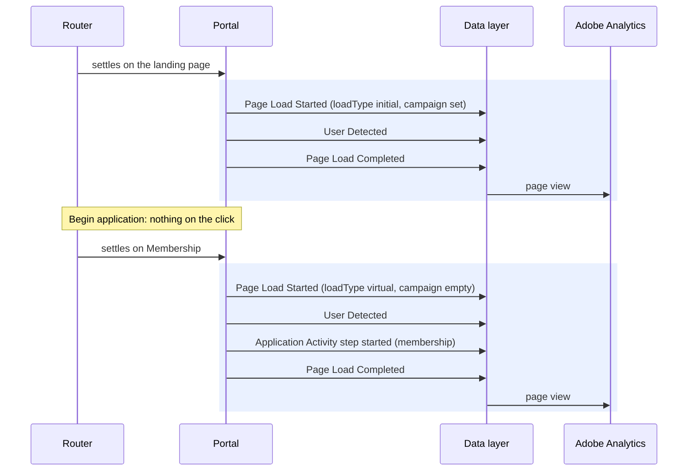

# Page Load Started

**Event name:** `Page Load Started` · Needed for your reports

[Back to the overview](../README.md)

## What it answers

- How many views each page and each application step gets.
- Which association's portal people are using.
- Which campaigns bring visitors in, and which page they enter on.
- Which landing version and layout they saw.

## When to fire it

- **Fire this event first on every page view:** when the portal first loads, and on every route change or navigation step within the portal, including soft transitions between views, since the app is a SPA and never triggers a full page load.
- **Fire it once the router has settled on the final page.** If one address redirects to another,
  only the final page counts.
- **Then fire** [User Detected](user-detected.md), any events that describe the page, and
  [Page Load Completed](page-load-completed.md).
- **Do not fire it** when only the `?` or `#` part of the address changes, or when a drawer or a
  window opens.
- **Send the page object whole every time**, so nothing from the previous page survives.

## Example

The visitor arrives from an email campaign, then moves from the landing page to the first
application step:



The first page of a visit records the campaign. Each later step is a new page view of the
single-page application (`loadType: "virtual"`), with the campaign left empty.

## Javascript code

```js
window.appEventData = window.appEventData || [];
window.appEventData.push({
  "event": "Page Load Started",
  "page": {
    "pageName": "<pageName>",
    "pageId": "<pageId>",
    "pageType": "<pageType>",
    "association": "<association>",
    "experience": "<experience>",
    "url": "<url>",
    "host": "<host>",
    "campaign": "<campaign>",
    "stage": "<stage>",
    "loadType": "<loadType>",
    "language": "<language>",
    "environment": "<environment>"
  }
});
```

## Populated example

```js
window.appEventData = window.appEventData || [];
window.appEventData.push({
  "event": "Page Load Started",
  "page": {
    "pageName": "home|landing",
    "pageId": "landing",
    "pageType": "home",
    "association": "waepa",
    "experience": "hero-image|multi",
    "url": "https://waepa.nylinsure.com/?association=waepa&campaign=waepa-oe-2026-email&variant=hero-image",
    "host": "waepa.nylinsure.com",
    "campaign": "waepa-oe-2026-email",
    "stage": null,
    "loadType": "initial",
    "language": "en-us",
    "environment": "production | New Experience Site"
  }
});
```

## Variable definitions

All 12 details are sent every time; a detail that does not apply is `null`.

| Path | Type | Description | Example |
|---|---|---|---|
| `page.pageName` | string | Required. For your reports. The page's reporting name: page type, then page id. Proposed ([decisions 5 and 16](../open-questions.md)) | `home\|landing`, `application\|eligibility` |
| `page.pageId` | string | Required. For your reports. The page's id, from the route table ([decision 16](../open-questions.md)) | `landing`, `eligibility`, `receipt` |
| `page.pageType` | string | Required. For your reports. The page group ([table below](#page-type-and-stage-by-page)) | `home`, `application`, `confirmation` |
| `page.association` | string | Required. For your reports. The association whose portal is shown. Set by the site, never guessed from the address ([decisions 2 and 13](../open-questions.md)) | `waepa`, `abe` |
| `page.experience` | string | Required. Recommended. The landing version and layout, kept for the whole visit | `hero-image\|multi` |
| `page.url` | string | Required. For your reports. The page's address, with every unlisted parameter removed ([below](#how-the-address-is-cleaned)) | `https://waepa.nylinsure.com/eligibility` |
| `page.host` | string | Required. For your reports. The portal's web address, lower case. Kept separate from the association, because existing segments rely on it | `waepa.nylinsure.com` |
| `page.campaign` | string or null | For your reports. The `campaign` address parameter, on the first page of a visit only, at most 30 characters ([decision 6](../open-questions.md)) | `waepa-oe-2026-email`, `null` |
| `page.stage` | string or null | Recommended. The application stage ([table below](#page-type-and-stage-by-page)); `null` outside the application | `getting-started`, `null` |
| `page.loadType` | string | Required. Recommended. `initial` for the first page of a page load (including a reload and the return from DocuSign); `virtual` for a change of step | `initial`, `virtual` |
| `page.language` | string or null | Recommended. The page's language | `en-us` |
| `page.environment` | string | Required. Recommended. The build and the site, written `"<build> \| <site>"`: production, staging or development, then the site experience, so the new portal is told apart from the legacy site in the shared Adobe Launch property. The legacy site's label is [decision 25](../open-questions.md) | `production \| New Experience Site` |

### Page type and stage by page

Proposed until the production route table is confirmed ([decision 16](../open-questions.md)).

| Page id | Page type | Stage |
|---|---|---|
| `landing` | `home` | none |
| `membership`, `eligibility` | `application` | `getting-started` |
| `coverage` | `application` | `coverage-options` |
| `beneficiary`, `contact`, `profile` | `application` | `profile` |
| `review`, `health-si`, `health-li`, `health-qd`, `health-di`, `health-cir`, `payment` | `application` | `application-review` |
| `docusign` | `application` | `esign-submit` |
| `receipt` | `confirmation` | none |
| `resume`, `resume-method`, `resume-code` | `resume` | none |
| `advisor-login`, `advisor-send-confirmation`, `application-edit-confirmation` | `advisor` | none |
| `not-found` | `error` | none |

### How the address is cleaned

An address can carry personal details (a benefit amount, a token, an ad click id), so the site
cleans it before adding it:

- **Keep** the scheme, the host and the page's path, plus only these parameters: `association`,
  `campaign`, `URLClickedFrom`, `form`, `flow`, `variant`, `template`, `apply`, `prods`,
  `featured_prod`.
- **Remove** every other parameter and the `#` part. For an unknown page, the path becomes
  `/not-found`.
- **The campaign code comes from the address the visitor arrived on**, even if the site removes it
  from the address bar afterwards.

| Address in the browser | `page.url` |
|---|---|
| `https://waepa.nylinsure.com/?association=waepa&campaign=waepa-oe-2026-email&gclid=abc123&amt=250000` | `https://waepa.nylinsure.com/?association=waepa&campaign=waepa-oe-2026-email` |
| `https://waepa.nylinsure.com/?URLClickedFrom=email&token=4f9c2a7b` | `https://waepa.nylinsure.com/?URLClickedFrom=email` |
| `https://waepa.nylinsure.com/membershp` (a mistyped page) | `https://waepa.nylinsure.com/not-found` |

## How to check it

1. In the browser console, `appEventData.map(e => e.event)` shows Page Load Started first on every
   page and step.
2. Open the portal with `?campaign=test-campaign&amt=250000`. `page.url` keeps `campaign` and drops
   `amt`, and `page.campaign` is `test-campaign` on the first page only.
3. Move to another step: a new Page Load Started with `loadType: "virtual"`.
