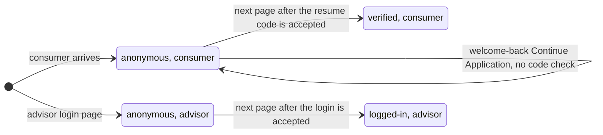

# User Detected

[Back to the overview](../README.md) · Recommended

**What it records:** who is visiting, in two details: whether the visitor's identity was checked
in this visit, and whether they are a consumer or an advisor. **Never who they are:** no name,
email, phone number or customer id.

## When to add it

- **Once per page view, second:** right after [Page Load Started](page-load-started.md), on every
  page and step.
- Adobe Launch attaches these two details to every later hit of the page view, so the other events
  never repeat them.

## How the visitor's status changes

Each box is what User Detected sends. The status changes **between page views, never in the middle
of one**: the hit that records a successful code check still carries the old status, and the next
page carries the new one.



**Consumers do not log in on the new portal.** They resume an application with their email and a
code. Only advisors log in. What the old "login success" measure should mean now is
[decision 3](../open-questions.md).

## Example

```js
window.appEventData.push({
  "event": "User Detected",
  "user": {
    "loginStatus": "anonymous",
    "userType": "consumer"
  }
});
```

## Properties

| Property | Required | What it holds | Values |
|---|---|---|---|
| `user.loginStatus` | yes | Whether the visitor's identity was checked in this visit. When more than one applies, the strongest wins | `anonymous` (no check), `verified` (a consumer passed the resume email and code check), `logged-in` (an advisor is logged in) |
| `user.userType` | yes | Which experience the visitor is in | `consumer`, `advisor`, `advisor-applicant` (an applicant reviewing an application an advisor prepared) |

**Valid pairs:** `anonymous` or `verified` with `consumer`; `anonymous` or `logged-in` with
`advisor`; `anonymous` or `verified` with `advisor-applicant`. Any other pair is a defect.

## Key rules

1. **Sent whole on every page view**; neither detail is ever empty.
2. **Set by the site's own session state**, never guessed from the page or the address.
3. **No personal identifiers, ever**, not even a scrambled one.

## How to check it

1. On every page, User Detected comes right after Page Load Started.
2. Resume an application with a test email and code: the page that confirms the code still shows
   `anonymous`; the next page shows `verified`.
