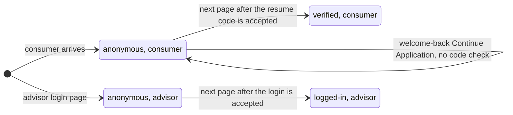

# User Detected

**Event name:** `User Detected` · Recommended

[Back to the overview](../README.md)

## What it answers

- How many visitors are consumers, advisors, or applicants reviewing an advisor's work.
- How many consumers resume an application by checking their identity.
- How many advisors log in.
- Never who anyone is: no name, email, phone number or customer id. A proposed anonymous id stays
  empty until New York Life approves it ([decision 20](../open-questions.md)).

## When to fire it

- **Fire this event second on every page view**, right after
  [Page Load Started](page-load-started.md), on every page and step.
- **Set these details from the site's own session state**, never from the page or the address.
- **The status changes after a [Login Activity](login-activity.md) "succeeded"**, on the next page.
- **The status changes between page views, never in the middle of one.** The page that confirms a
  code or a login still carries the old status; the next page carries the new one.
- Adobe Launch attaches these two details to every later hit of the page view, so the other events
  never repeat them.

## Example

Each box is what User Detected sends:



**Consumers do not log in on the new portal.** They resume an application with their email and a
code. Only advisors log in. Your login success count includes both: every Login Activity
`succeeded`, by credentials or by email and code ([decision 3](../open-questions.md), answered
2026-10-25).

## Javascript code

```js
window.appEventData = window.appEventData || [];
window.appEventData.push({
  "event": "User Detected",
  "user": {
    "loginStatus": "<loginStatus>",
    "userType": "<userType>",
    "id": "<id>"
  }
});
```

## Populated example

A consumer on the first page after a successful resume code check:

```js
window.appEventData = window.appEventData || [];
window.appEventData.push({
  "event": "User Detected",
  "user": {
    "loginStatus": "verified",
    "userType": "consumer",
    "id": null
  }
});
```

## Variable definitions

| Path | Type | Description | Example |
|---|---|---|---|
| `user.loginStatus` | string | Required. Recommended. Whether the visitor's identity was checked in this visit. When more than one applies, the strongest wins: `logged-in`, then `verified`, then `anonymous` | `anonymous` (no check), `verified` (a consumer passed the resume email and code check), `logged-in` (an advisor is logged in) |
| `user.userType` | string | Required. Recommended. Which experience the visitor is in | `consumer`, `advisor`, `advisor-applicant` (an applicant reviewing an application an advisor prepared) |
| `user.id` | string or null | Proposed. An anonymous id issued by New York Life's systems for a logged-in advisor or a verified consumer, never a name, email, phone number or policy number. **Empty until New York Life approves it** ([decision 20](../open-questions.md)) | `null` |

**Valid pairs:** `anonymous` or `verified` with `consumer`; `anonymous` or `logged-in` with
`advisor`; `anonymous` or `verified` with `advisor-applicant`. Any other pair is a defect.

## How to check it

1. On every page, User Detected comes right after Page Load Started; `loginStatus` and `userType`
   are never empty, and `id` is empty.
2. Resume an application with a test email and code: the page that confirms the code still shows
   `anonymous`; the next page shows `verified`.
