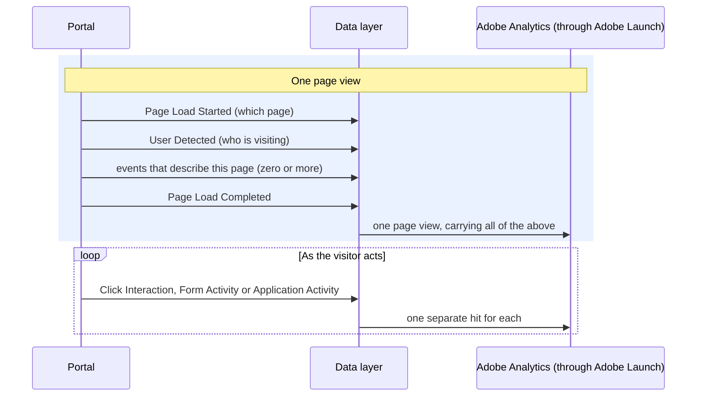
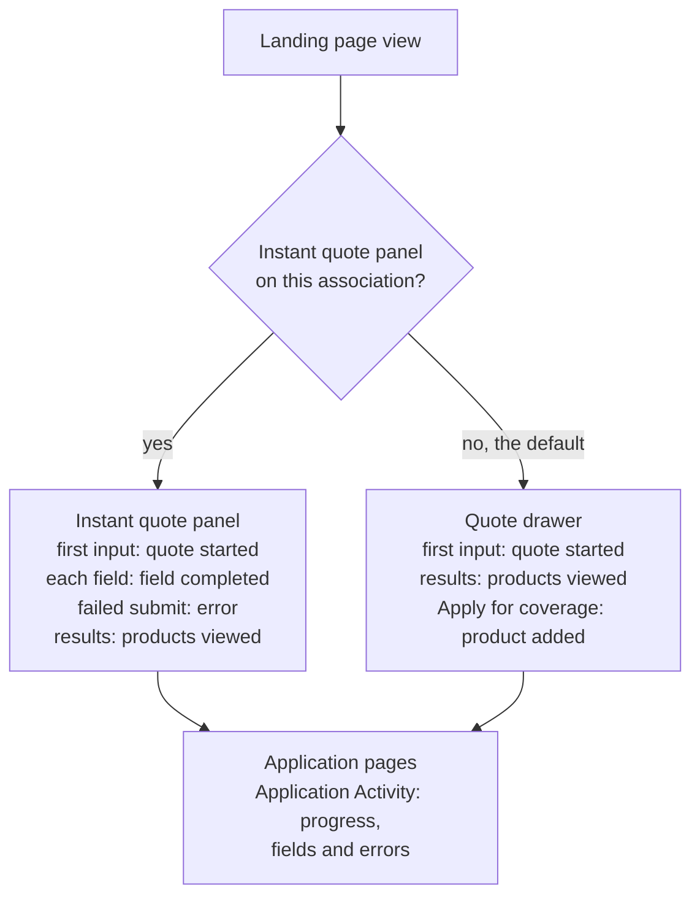

# How it works

[Back to the overview](README.md)

## The idea

The portal is a single-page application: moving from one step to the next changes the screen
without loading a new web page. So the site has to say, in a message, each time something
meaningful happens. Each message is an **event**: a small object with a name and the details that
belong to it, added to a shared list on the page:

```js
window.appEventData = window.appEventData || [];
window.appEventData.push({ "event": "Page Load Started", "page": { ... } });
```

**Adobe Launch**, the tag manager, listens to that list. For each event it decides what to send to
Adobe Analytics. The site never decides what Adobe receives, and it never reads the screen, the
address or the visible text to guess what happened: it says what happened.

**Developers choose how to produce the events.** This specification defines what each event
contains and when it is added, not the code that adds it.

## Every page view, step by step

Every page view, including each step of the application, is wrapped by the same three events:



- **Events that describe the page** (for example "the Eligibility step was viewed") are added
  between User Detected and Page Load Completed, so they travel with the page view.
- **Everything the visitor does afterwards** (a click, an error, an added product) is its own hit,
  sent when it happens. That stays true even if it happens before the page has finished loading.
- **Two actions stay in the data layer only** for now and are not sent to Adobe: a form field
  being completed, and a step of the application being completed. Sending them would add server
  calls, which needs your agreement ([decision 9](open-questions.md)).

## Which event fires where: the two landing experiences

The landing page comes in two versions, depending on the association's configuration:
- **with the instant quote panel** (date of birth, ZIP code, state, then "Get an instant quote"),
  as on the American Bar Endowment portal;
- **without it** (the default design), where quoting happens in the quote drawer.

**One rule covers both:**
- **Application Started, Application Activity and Application Completed record progress** through
  the quote and the application: the application started (Start); a quote started, products
  viewed, products committed to the cart, each step (Activity); the submission (Complete). The
  same on every experience.
- **Application Activity also records how the application and the quote forms are used:** a
  field completed, and a Next or "Get an instant quote" that is blocked (an error).
- **Login Activity records identity checks:** the advisor login and the consumer's resume code.
- **Form Activity is reserved for supplemental forms** (shown, steps, fields completed, errors):
  the resume and advisor login forms today, and a future form such as Contact Us. It never fires
  inside the application or the quote.
- **The milestone wins.** Its first
  input is recorded as "quote started", "application started" or "login started", and a
  successful submit as "products viewed", the next step or "login succeeded". Nothing is counted
  twice.



| Where | Application Activity | Form Activity |
|---|---|---|
| Landing page **with** the instant quote panel | quote started (first input), field completed, error (a blocked "Get an instant quote"), products viewed (results) | none |
| Landing page **without** it, and the quote drawer | quote started, products viewed, product added (on "Apply for coverage") | none |
| Application pages, Membership to Payment | Application Started (first input on Membership); Activity: step started, saved, field completed, error, step completed, product added (on a Next on Coverage that passes validation), product removed (on a confirmed removal), signature started; Application Completed on the receipt | none |
| Resume pages and the advisor login | resumed, on the first page after a successful resume | viewed, step viewed, field completed, error; the login itself is Login Activity (started, succeeded, failed) |

## One action, one event

A single thing the visitor does produces at most one of Click Interaction, Form Activity, Login
Activity or Application Activity. Take the first that applies:

1. **Is it something in the quote or the application** (progress, a field, an error)? Use
   Application Started, Application Activity or Application Completed, when the result happens,
   not on the click.
2. **Is it a step of a login or resume check?** Use Login Activity.
3. **Is it a change in how a supplemental form is used?** Use Form Activity.
4. **Is it a click on a tracked control?** Use Click Interaction.
5. **Otherwise,** add nothing.

Messages the system shows by itself ("Progress saved", "Coverage added", the cookie banner) add
nothing.

| What the visitor does | What is recorded |
|---|---|
| Begin application | Nothing on the click; the next page records the step |
| First answer on the Membership page | Application Started (or Application Activity: knocked out, if the answer is "not a member") |
| Next on a step, and it passes validation | Nothing is sent on the click; the next page records the step |
| Next on a step, and it fails validation | Application Activity: error |
| First input in the instant quote panel | Application Activity: quote started |
| "Get an instant quote" returns results | Application Activity: products viewed |
| "Get an instant quote" fails validation | Application Activity: error |
| Add or Add coverage on a product card | Nothing yet: the cart is recorded on Next on Coverage, or on "Apply for coverage" in the quote drawer (Application Activity: product added) |
| Remove a product, and confirm | Application Activity: product removed |
| Edit or Print on the Review page | Click Interaction: a window opens, or print |
| Application PDF on the receipt | Click Interaction: download |
| Chat now, Schedule a call, a phone or email link | Click Interaction: contact |
| Next on the signature page | Application Activity: signature started |
| The receipt page shows its confirmation number | Application Completed, once per receipt number |
| Verification code accepted when resuming | Login Activity: succeeded |
| Wrong code, or wrong advisor credentials | Login Activity: failed |
| Advisor login accepted | Login Activity: succeeded |

## What every hit carries

Developers send page and visitor details **once per page view**, on Page Load Started and User
Detected. Adobe Launch then attaches them to every hit of that page view, so they are never
repeated on the other events:

| Detail | What it is |
|---|---|
| Page name, page id | Which page or step |
| Association | Which association's portal |
| Experience | The landing version and layout |
| Page address | The address, with personal details removed ([Privacy](privacy.md)) |
| Host | The portal's web address, kept separate from the association |
| Environment | The build and the site, for example `production \| New Experience Site`, so the new portal is told apart from the legacy site |
| Login status, visitor type | Consumer or advisor, and whether their identity was checked |

The campaign code is the exception: it is recorded on the first page of a visit only, and Adobe
carries it from there. Every detail, and the Adobe metric each event sets, is listed in
[Global context and metrics](reference/global-context.md).

## Each event is complete, and only describes itself

- Every event is sent **whole every time**: a detail that does not apply is sent as empty
  (`null`), never left out. Details from an earlier event can never leak into a later one.
- **Each event has one main object** (`interaction`, `form` or `application`). The products a
  visitor sees sit inside the application object. One object per event keeps the data layer
  clean as a single-page application keeps adding events.
- The page and visitor details come only from the latest Page Load Started and User Detected.
